<h1 align="center">PanWatch — セルフホスト型 AI 株式モニタリング</h1>

<p align="center">
  <a href="README.md">English</a> | <a href="README.zh-CN.md">简体中文</a> | <a href="README.ja.md">日本語</a>
</p>

<p align="center">
  中国 A 株、香港株、米国株をモニタリングし、ポートフォリオを管理し、<a href="https://github.com/TauricResearch/TradingAgents">TradingAgents</a> で投資アイデアをリサーチできます。お好みの OpenAI 互換プロバイダー、または Ollama 経由のローカルモデルで PanWatch をセルフホストできます。
</p>

<p align="center">
  <a href="#-機能一覧">機能一覧</a> · <a href="#主な機能">主な機能</a> · <a href="#クイックスタート">クイックスタート</a> · <a href="#リファレンス">リファレンス</a> · <a href="#プロジェクトを支援する">支援</a> · <a href="#コントリビュート">コントリビュート</a>
</p>

<p align="center">
  <a href="https://github.com/TNT-Likely/PanWatch/stargazers"></a>
  <a href="https://hub.docker.com/r/sunxiao0721/panwatch"></a>
  <a href="LICENSE"></a>
  <a href="https://github.com/TNT-Likely/PanWatch/commits/main"></a>
  <a href="https://github.com/TNT-Likely/PanWatch"></a>
</p>

<p align="center">
  <a href="https://www.star-history.com/tnt-likely/panwatch">
    <picture>
      <source media="(prefers-color-scheme: dark)" srcset="https://api.star-history.com/badge?repo=TNT-Likely/PanWatch&type=trending&theme=dark" />
      <source media="(prefers-color-scheme: light)" srcset="https://api.star-history.com/badge?repo=TNT-Likely/PanWatch&type=trending" />
      
    </picture>
  </a>
</p>

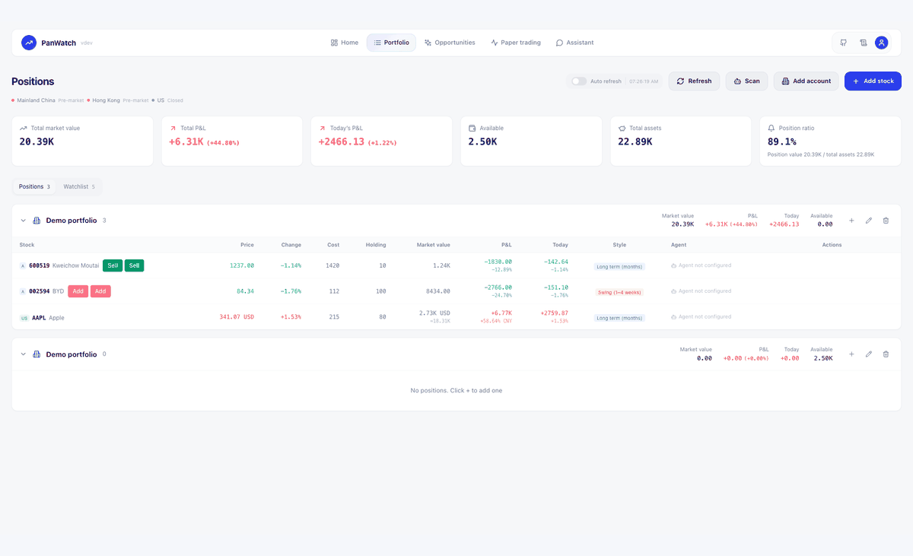

> 🧠 **ポートフォリオの保有銘柄から始めて → 9 つのエージェントからなる TradingAgents のリサーチチームに分析させ → 強気/弱気の議論とリスクレビューを追い → 3〜5 分以内に、PM の意思決定メモと推論の全過程をメッセージアプリで受け取れます。**

<details open>
<summary>❤️ スポンサー</summary>

| ロゴ | 紹介 |
| --- | --- |
| <a href="https://88api.ai/sign-up?aff=W38W">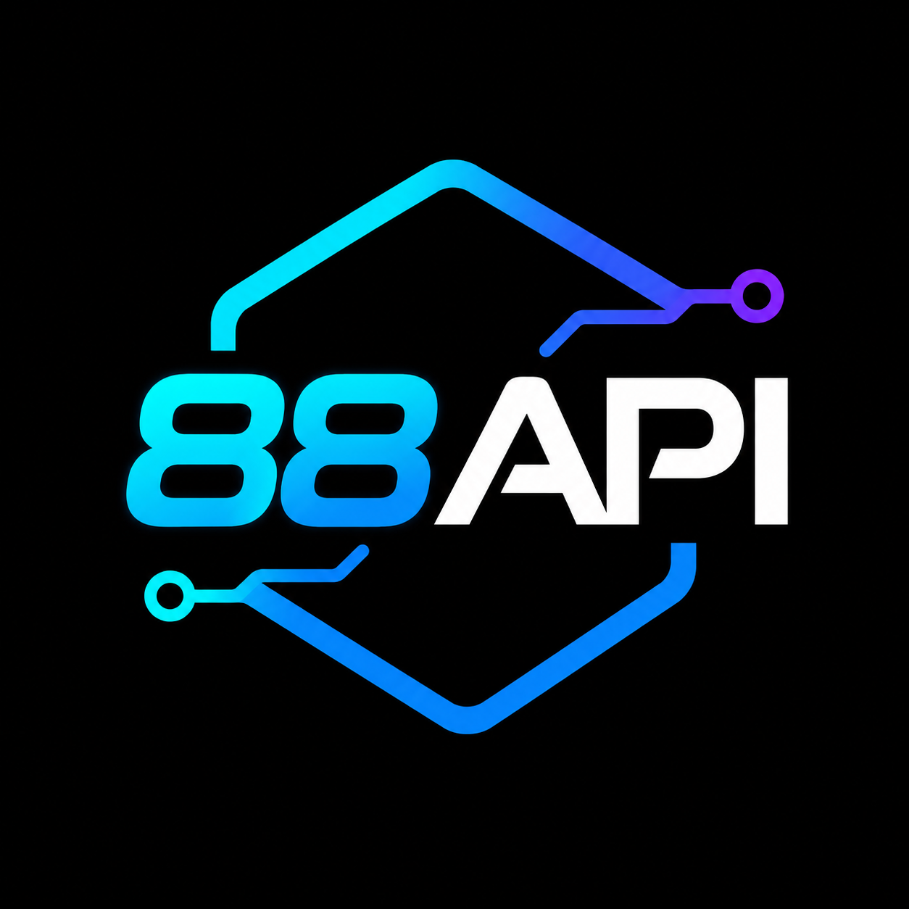</a> | [**88API トークン集約プラットフォーム**](https://88api.ai/sign-up?aff=W38W)<br><br>🧠 GPT、Claude、Gemini、Grok、DeepSeek、Kimi、GLM などの言語モデルやコーディングモデルを利用できます。<br>🎨 画像モデル: GPT-Image、Gemini、Grok など。<br>🎬 動画モデル: Seedance、Veo、MiniMax H3、Kling、Grok など。<br>🎙️ 音声機能: Whisper、TTS など。文章作成から画像の生成・編集、動画生成やナレーションまで対応しています。<br>🎁 新規ユーザーは登録時にトライアルクレジットを受け取り、モデルの性能を試せます。サイトではライブのカスタマーサポートも利用できます！<br>👉 香港の登記企業が運営 · 安定した可用性 · フル機能のサービスを完全に提供 · モデルの性能を落とすことはありません · 請求書の発行に対応<br><br>[**今すぐ登録 →**](https://88api.ai/sign-up?aff=W38W) |

</details>

## 📸 機能一覧

以下のスクリーンショットは英語のインターフェースを使用しています。同じ製品画面のすべてで簡体字中国語も利用できます。

| ポートフォリオ · 複数口座の概要 | 投資機会 · AI がスコアリングしたアイデア |
|:---:|:---:|
| 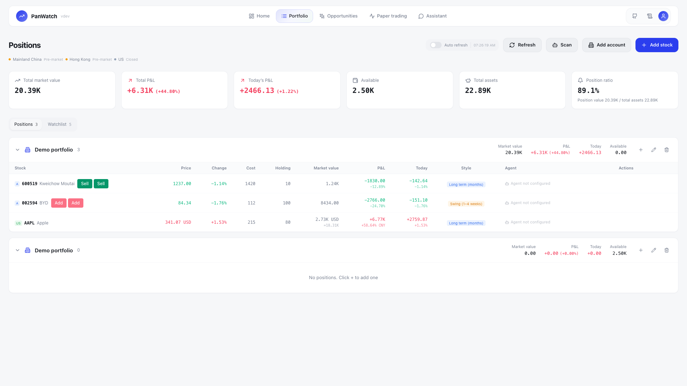 | 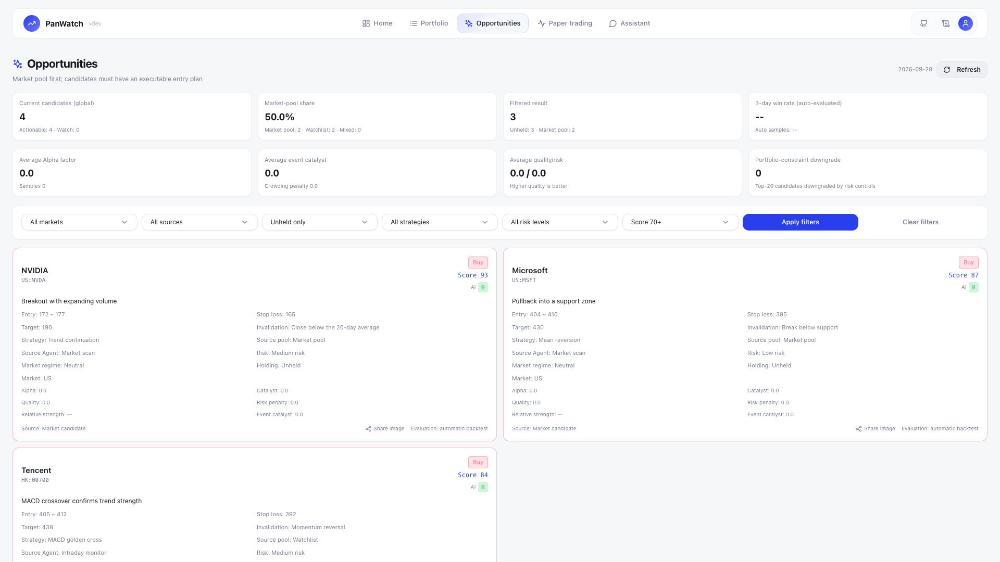 |
| **ペーパートレード · 資産曲線とパフォーマンス** | **銘柄の詳細分析** |
| 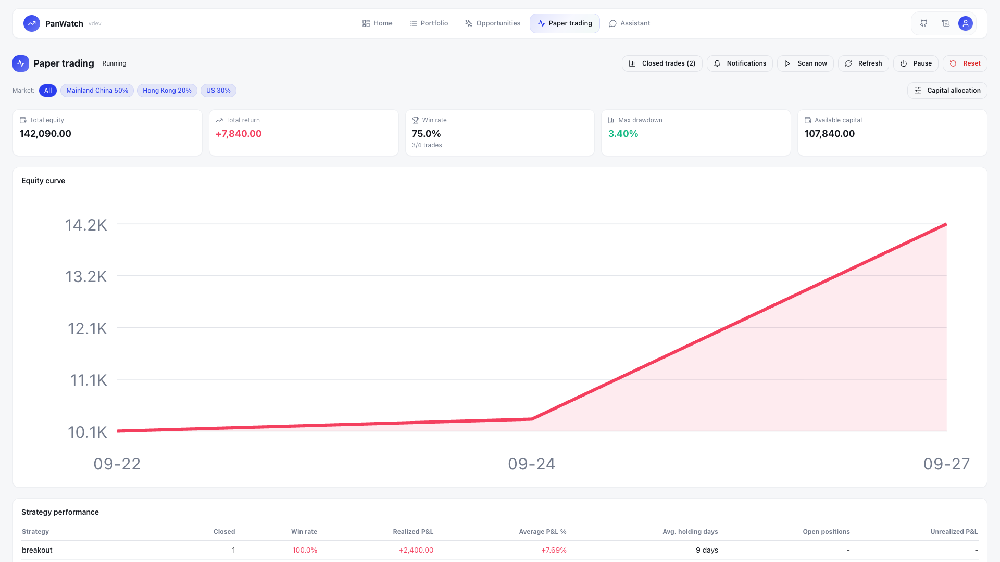 | 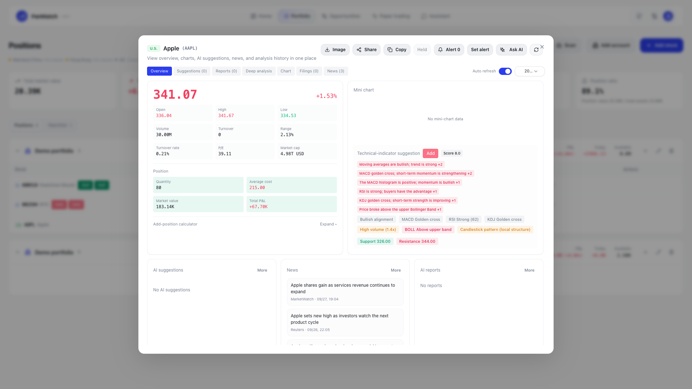 |
| **テクニカルのコンフルエンス · MACD/RSI/KDJ をひと目で** | **価格アラート · 複合条件** |
| 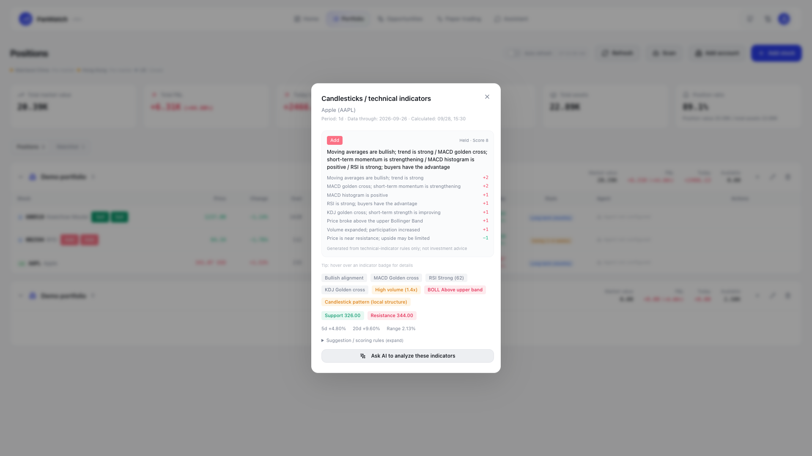 | 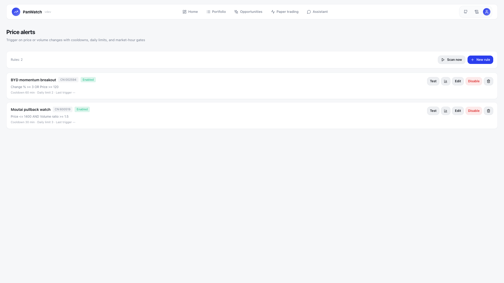 |

<details>
<summary>モバイルのスクリーンショット</summary>

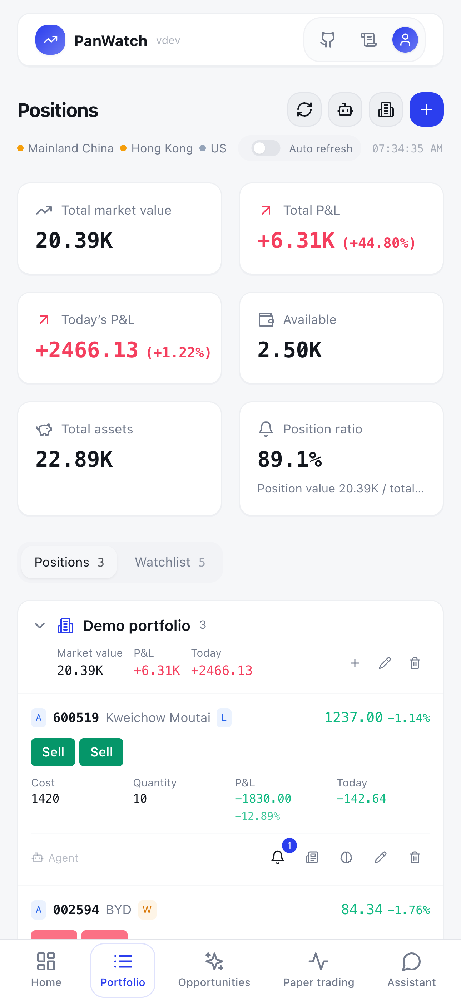 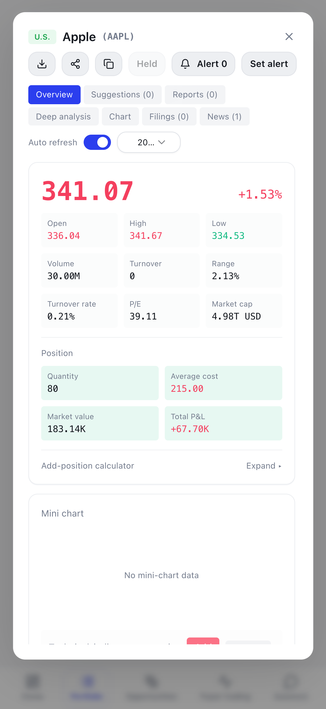

> 📱 PanWatch はインストール可能な PWA で、ネイティブアプリのようにモバイルのホーム画面に追加できます。

</details>

> 💡 PanWatch が役に立った場合は、ぜひプロジェクトに ⭐ **Star** を付けることをご検討ください。それがプロジェクトを支援し、より多くの人に知ってもらうための最良の方法です。

## 主な機能

| 機能 | できること |
|---|---|
| **ポートフォリオ** | 複数の証券口座を管理し、保有銘柄と損益を追跡し、トレードスタイルを設定できます。 |
| **AI リサーチ** | テクニカル、センチメント、ニュース、ファンダメンタルズの分析を、議論、リスクレビュー、ポートフォリオマネージャーの意思決定を通じて確認できます。 |
| **スケジュール実行エージェント** | 設定したスケジュールに従い、対象となる取引所の取引日に寄り付き前、ザラ場中、大引けのワークフローを実行します。 |
| **価格アラート** | AND/OR ロジックで条件を組み合わせ、クールダウン、1 日あたりの上限、有効期限、通知チャンネルを設定できます。 |
| **投資機会** | エントリー水準、目標値、リスクの文脈付きでランク付けされた候補を確認できます。 |
| **ペーパートレード** | シグナルに基づくエントリーとエグジットをシミュレーションし、資産とパフォーマンスを追跡できます。 |
| **通知** | Telegram、WeCom、DingTalk、Feishu、Bark、または Webhook でレポートやアラートを配信します。 |
| **モバイル** | PWA をホーム画面にインストールし、スマートフォンでも同じワークスペースを利用できます。 |

株式と上場 ETF の検索、ウォッチリスト、保有銘柄、価格アラート、相場、ローソク足は、中国本土、香港、米国の市場で同じワークフローを共有しています。コードまたは名前で検索できます（例: `510300`、`159915`、`02800`、`SPY`）。資産タイプは銘柄ごとに保存されます。プロバイダー側の名称から ETF であると判別できないファンドには **ETF** を選択してください。

ETF の詳細分析ではファンド固有の文脈を使用し、企業の財務諸表で代用することはありません。ファンドの組入銘柄、基準価額、手数料、トラッキングエラーは、まだ構造化データとして提供されていません。ペーパートレードは引き続き既存の市場ルールとコストモデルを使用します。ETF 固有の T+0 の例外や手数料体系はモデル化されていません。

## クイックスタート

```bash
docker run -d \
  --name panwatch \
  --restart unless-stopped \
  -e TZ=Asia/Shanghai \
  -p 8000:8000 \
  -v panwatch_data:/app/data \
  sunxiao0721/panwatch:latest
```

`http://localhost:8000` を開き、ログイン認証情報を作成してください。

バックグラウンドのスケジュールと通知のおやすみ時間のために `TZ` を明示的に設定してください。例:
`-e TZ=UTC` または `-e TZ=America/New_York`。イメージのデフォルトは `Asia/Shanghai` で、
ホストのタイムゾーンは検出しません。インターフェースのタイムスタンプとアラートの有効期限の入力には
ブラウザーのタイムゾーンが使われます。[タイムゾーンのポリシー](docs/timezones.md)

<details>
<summary>初期セットアップ</summary>

1. Web インターフェースを開き、ログイン認証情報を作成します。
2. 初回サインイン時にメインツアーが開き、銘柄、相場、AI のセットアップ、最初の分析を順に案内します。必須のステップはスキップできませんが、一時停止して再開できます。ツアーは **ガイドセンター** から再度開けます。ガイドセンターでは、投資機会、ペーパートレード、アシスタント、デイリータスク、データソースのガイドも提供しており、それぞれ進捗が保存され、再生できます。ハイライトされたコントロールを直接クリックしてください。メインツアーは保存された操作や成功したチェックを検証し、探索ルートでは確認済みの手順を記録します。
3. メインツアーで **Settings → AI Services** にサービスを設定し、デフォルトモデルを設定して接続をテストしてから、最初の分析を明示的に生成します。この操作ではモデルのクォータを使用し、結果はページ上に残ります。
4. 必要に応じて価格アラートを作成し、通知チャンネルをテストします。ガイドは後回しにしたり再開したりでき、進捗はブラウザーの変更やサービスの再起動後も保持されます。モデルやチャンネルの設定を変更した場合は、新たにテストを成功させる必要があります。
5. 基本的な機能が動作したら、スケジュール実行エージェントを有効にするか、TradingAgents を試してみてください。これらは最初の分析とは別に設定します。

</details>

<details>
<summary>Docker Compose</summary>

```yaml
services:
  panwatch:
    image: sunxiao0721/panwatch:latest
    container_name: panwatch
    environment:
      TZ: "Asia/Shanghai"
    ports:
      - "8000:8000"
    volumes:
      - panwatch_data:/app/data
    restart: unless-stopped

volumes:
  panwatch_data:
```

```bash
docker compose up -d
```

`environment.TZ` をお使いの IANA タイムゾーンに変更し、`docker compose up -d` を実行して
コンテナを再作成してください。変更する前に、既存の cron とおやすみ時間の時刻を確認してください。
同じ `09:00` のスケジュールでも、実行される瞬間が変わります。データボリュームは残しておいてください。

</details>

<details>
<summary>初回起動とブラウザーのインストール</summary>

イメージには Playwright のシステム依存関係が含まれています。スクリーンショット用の Chromium ヘッドレスシェルは、初回起動時にマウントされたボリューム（デフォルトは `/app/data/playwright`）にダウンロードされます。これにはネットワークアクセスが必要で、数分かかる場合があります。

スクリーンショットなどのブラウザー機能が不要な場合は、`PLAYWRIGHT_SKIP_BROWSER_INSTALL=1` を設定するとこのインストールをスキップできます。

</details>

## リファレンス

<details>
<summary>スケジュール実行エージェントと詳細分析</summary>

| エージェント | 目的 |
|---|---|
| **寄り付き前の見通し** | 夜間の値動き、ニュース、テクニカル構造をまとめて計画を立てます。 |
| **ザラ場中のモニター** | 取引時間中の異常な値動きやテクニカルシグナルを監視します。 |
| **デイリーレポート** | その日の取引を振り返り、翌取引日の計画を準備します。 |

スケジュールは設定可能です。自動実行では、データ収集と分析の前に取引所の休場日を除外します。ザラ場中のワークフローでは、取引セッションが開いていることも必要です。

保有銘柄の横にある脳のアイコンを選択すると、TradingAgents による詳細分析を開始できます。4 つのアナリストのロールが強気/弱気の議論、リスクレビュー、ポートフォリオマネージャーの意思決定へとつながり、推論の過程はアプリ内と設定済みの通知チャンネルで確認できます。実行時間とコストは、選択したモデルと設定によって異なります。

[詳細分析のフローチャート](docs/tradingagents-flow.en.md) · [バックエンドのアーキテクチャ](src/ARCHITECTURE.en.md)

</details>

<details>
<summary>市場カレンダーとスケジュール</summary>

- 市場ステータスのストリップを選択すると、3 つの取引所すべてを今後 14 日分の日付で比較できます。取引開始/セッションの時刻はブラウザーのタイムゾーンを、取引日とステータスは各取引所の現地日付を使用します。
- 非取引日は「休場」と表示され、取引を終えた取引日は「取引終了」と表示されます。北京の土曜日の朝は、ニューヨークではまだ金曜日の取引終了後である場合があります。
- 公表済みの 2026 年の休場日と半日取引日はローカルに同梱されています。起動時には過去 30 日と今後 90 日分のみを準備し、全履歴はダウンロードしません。未公表の平日は「カレンダー未確定」と表示され、自動実行がブロックされます。翌年分については、同梱の年間データを更新する必要があります。
- エージェントの Cron/間隔の設定は変わりません。実行とスケジュールのプレビューは同じカレンダーフィルターを共有します。「終日」モードの価格アラートでも、取引日であることが必要です。
- ペーパートレードの約定には、その銘柄の市場の取引セッションが開いている必要があります。ペーパートレードの通知は、半日取引日や米国のサマータイムの切り替えを含め、各取引所の現地時刻に従います。
- 中国本土のペーパートレードのポジションは、上海での購入日を基準に T+1 に従います。購入日には自動・手動のどちらの売却もブロックされ、24 時間待つことなく翌取引日から売却できます。ロック中も価格と含み損益は更新され続けます。損切り、利益確定、その他のエグジット条件は、売却が可能になった時点でその時の相場を使って再度チェックされます。
- ペーパートレードの現金の受け渡しは、売却の可否とは別に扱われます。A 株は T+1 で受け渡され、売却代金をすぐに新規購入に充てられます。香港（T+2）と米国（T+1）では、受け渡し済みで拘束されていない資金でのみ購入できる現金口座を使用します。ページには、現金残高、買付余力、受け渡し済みの利用可能な現金、未受け渡しの売却代金が表示されます。購入時には現金がすぐに拘束されます。受け渡しによって利用可能額が変わりますが、現金や損益が再度計上されることはありません。
- 受け渡し日は各市場の現地カレンダーを使用します。香港の半日取引日は受け渡しを行わない日です。米国のコロンブス・デーと退役軍人の日も、株式の取引が行われていても受け渡しが延期されます。シミュレーションでは、日中の清算バッチ、出金の締め切り、信用取引、為替、証券会社固有の制度をモデル化するのではなく、期日の開始時に資金を解放します。既存の残高は受け渡し済みの初期資金として扱われ、過去の取引が遡ってロックされることはありません。将来のカレンダーが不明な場合、新たな未受け渡しの売却代金は、カレンダーデータが更新されるまで保留されます。
- ルールの参照先: [HKEX の受け渡しと半日取引](https://www.hkex.com.hk/-/media/HKEX-Market/Services/Circulars-and-Notices/Participant-and-Members-Circulars/SEHK/2025/ce_SEHK_CT_075_2025.pdf)、[SEC T+1](https://www.sec.gov/exams/educationhelpguidesfaqs/t1-faq)、[DTC 2026 年の休日](https://www.dtcc.com/-/media/Files/pdf/2025/10/15/23034-25.pdf)。

</details>

<details>
<summary><b>本格的なテクニカル分析</b></summary>

- **トレンド指標:** 移動平均線の並び、MACD のクロス、ボリンジャーバンドのブレイクアウト。
- **モメンタム指標:** RSI の買われすぎ/売られすぎ、KDJ の張り付きやダイバージェンス。
- **価格と出来高:** 出来高比率の異常、出来高を伴わない押し目、出来高を伴うブレイクアウト。
- **パターン認識:** ハンマー、包み足、十字線などのローソク足パターン。
- **サポートとレジスタンス:** 複数のサポートラインとレジスタンスラインを自動で算出します。

</details>

<details>
<summary><b>価格アラート</b></summary>

- 価格、騰落率、売買代金、出来高比率などの条件を AND/OR ロジックで組み合わせられます。
- ルールを取引時間内に限定するか、取引日は終日有効にできます。クールダウン、1 日あたりのトリガー上限、繰り返しの動作を設定できます。
- ルールのダイアログで有効期限の日付と `HH:mm` 形式の時刻を設定できます。空欄にすると、ルールは期限切れになりません。
- ルールごとに通知チャンネルを選択できます。何も選択しない場合はシステムのデフォルトが使われます。

</details>

<details>
<summary>環境変数</summary>

| 変数 | 説明 | デフォルト |
|----------|-------------|---------|
| `AUTH_USERNAME` | 事前設定するログインユーザー名 | 初回アクセス時に設定 |
| `AUTH_PASSWORD` | 事前設定するログインパスワード | 初回アクセス時に設定 |
| `JWT_SECRET` | JWT の署名に使用するシークレット | 自動生成 |
| `DATA_DIR` | データの保存ディレクトリ | `./data` |
| `TZ` | エージェントのスケジュールと通知のおやすみ時間に使うデプロイ先のタイムゾーン。インターフェースの表示/入力にはブラウザーのタイムゾーンが使われます | `Asia/Shanghai` |
| `PLAYWRIGHT_SKIP_BROWSER_INSTALL` | ブラウザー機能が不要な場合に、初回の Chromium インストールをスキップします | 未設定 |
| `LOG_LEVEL` | コンソールのログレベル。`INFO` はビジネスイベントとエラーを出力します。スケジューラーのハートビート、収集ステップ、その他の診断情報には `DEBUG` を使用してください。UI のログパネルには常に完全なログが保持されます。 | `INFO` |
| `HTTP_PROXY` / `HTTPS_PROXY` / `http_proxy` | 外向きの HTTP プロキシ。外部の環境変数、`.env` 内の `http_proxy=http://host:port`、または **Settings → Global HTTP Proxy** で設定します。優先順位: 外部の環境変数 > UI > `.env`。`NO_PROXY` にはデフォルトで `localhost,127.0.0.1` が含まれます。 | 未設定 |
| `OTEL_EXPORTER_OTLP_ENDPOINT` | `http://jaeger:4318` などの OpenTelemetry OTLP エンドポイント。空の場合、エクスポートは完全に無効のままです。`requirements-otel.txt` のオプションの依存関係も必要です。 | 未設定（無効） |

</details>

<details>
<summary>ローカル開発</summary>

**要件:** Python 3.11+ / Node.js 24.14.0 / pnpm 9.15.9

```bash
# One-command development setup (recommended)
make dev-api          # Backend with automatic venv/dependencies on :8000
make dev-web          # Frontend with automatic pnpm install on :5183

# Or start each service manually
python -m venv venv && source venv/bin/activate
pip install -r requirements.txt
python server.py                              # Backend on :8000

cd frontend && pnpm install && pnpm dev       # Frontend on :5183
```

フロントエンドの開発サーバーは `http://localhost:5183` で動作し、`/api` を `127.0.0.1:8000` にプロキシします。


[フロントエンドの UI 規約とチェック](frontend/UI_GUIDELINES.md)

</details>

<details>
<summary><b>技術スタック</b></summary>

**バックエンド:** FastAPI / SQLAlchemy / APScheduler / OpenAI SDK

**フロントエンド:** React 18 / TypeScript / Tailwind CSS / shadcn/ui

</details>

<details>
<summary><b>OpenTelemetry エクスポート（オプション、デフォルトでは無効）</b></summary>

PanWatch には、構造化ログ、エンドツーエンドの `trace_id` による相関付け、`agent_runs` テーブル、ノード単位の TradingAgents の進捗とコストのレポートを備えたオブザーバビリティスタックが組み込まれています。外部サービスなしで動作します。

オプションで標準の [OpenTelemetry](https://opentelemetry.io/) エクスポートを追加し、Jaeger、Tempo、Langfuse、またはその他の互換 APM にトレースを送信できます。PanWatch は 3 種類のスパンをマッピングします:

- **1 回のエージェント実行** → `agent_runs` の `trace_id` と相関付けられたルートスパン。
- **1 回の LLM 呼び出し** → [OpenTelemetry GenAI セマンティック規約](https://opentelemetry.io/docs/specs/semconv/gen-ai/) に従った `gen_ai` の子スパン。`gen_ai.system`、`gen_ai.request.model`、入出力のトークン使用量、`gen_ai.operation.name` を含みます。
- **1 つの TradingAgents ノード** → ノード単位の進捗コールバックを再利用する子スパン。

オプションの依存関係がインストールされておらず、エンドポイントも設定されていない場合、エクスポートは完全に何もしません。

次の 3 ステップで有効にできます:

```bash
# 1. Install the optional dependencies
pip install -r requirements-otel.txt

# 2. Configure your collector or APM endpoint
export OTEL_EXPORTER_OTLP_ENDPOINT=http://localhost:4318
export OTEL_SERVICE_NAME=panwatch   # Optional; defaults to panwatch

# 3. Start PanWatch normally. The startup log will confirm that OTel export is enabled.
python server.py
```

ローカルで Jaeger インスタンスを実行して連携を確認できます:

```bash
docker run -d --name jaeger -p 16686:16686 -p 4318:4318 \
  jaegertracing/all-in-one:latest
# Trigger an agent, open http://localhost:16686, and select service=panwatch.
```

Langfuse と Tempo も同じように動作します。`OTEL_EXPORTER_OTLP_ENDPOINT` をそれぞれの OTLP エンドポイントに向けてください。

</details>

<details>
<summary><b>Docker イメージの公開</b></summary>

このリポジトリには GitHub Actions のリリースワークフローが含まれています:

- `0.2.3` のようなタグをプッシュすると、以下が自動でビルド・公開されます:
  - `sunxiao0721/panwatch:0.2.3`
  - `sunxiao0721/panwatch:latest`
- ワークフローは、`workflow_dispatch` とバージョンを明示して手動で開始することもできます。

公開する前に、次のリポジトリシークレットを設定してください:

- `DOCKERHUB_USERNAME`
- `DOCKERHUB_TOKEN`

</details>

## プロジェクトを支援する

### スポンサーシップ

スポンサーシップや提携に関するお問い合わせは、[sunxiaoyes@outlook.com](mailto:sunxiaoyes@outlook.com?subject=PanWatch%20sponsorship) までご連絡ください。

### 寄付

PanWatch は無料のオープンソースです。時間の節約やワークフローの改善に役立った場合は、継続的な開発を支援していただけます:

[](https://paypal.me/sunxiaoyes)
[](https://ko-fi.com/sunxiao)

<details>
<summary>Alipay / WeChat Pay</summary>

| Alipay | WeChat Pay |
|:---:|:---:|
|  |  |

</details>

<details>
<summary>USDT</summary>

**Binance Pay** — Binance アプリでスキャンしてください:

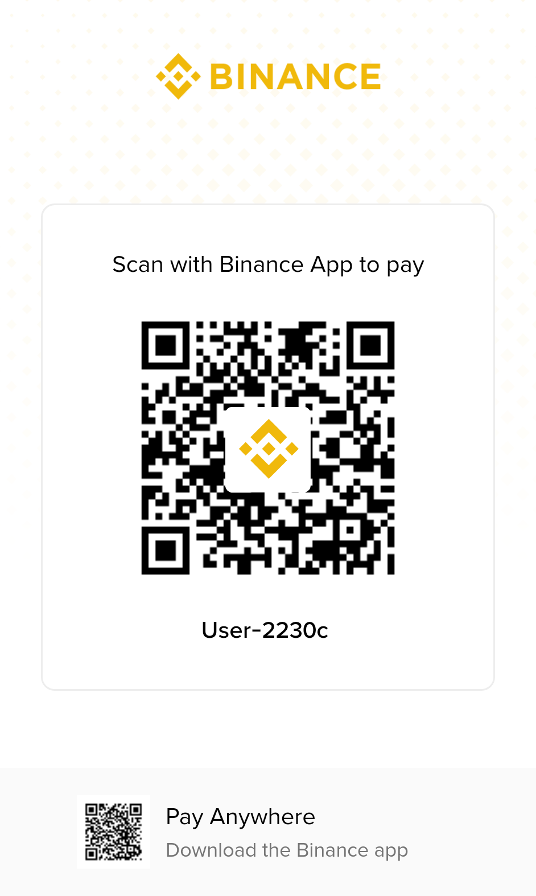

**オンチェーン USDT（TRC20）** — 任意の TRON ウォレットでスキャンしてください:

アドレス: `TKBV69B2AoU67p3vDhnJUbMJtZ1DxuUF5C`


</details>

## コントリビュート

Issue とプルリクエストを歓迎します。セットアップ、検証、国際化、カスタムエージェント、マーケットデータのソースについては、[コントリビューションガイド](CONTRIBUTING.md) を参照してください。

コミュニティチャット（Telegram）: [t.me/panwatch](https://t.me/panwatch)

## ライセンス

[MIT](LICENSE)
