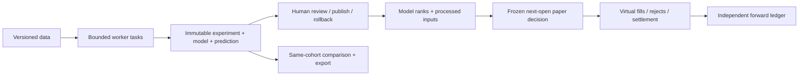

# Qlib research workbench

[简体中文](qlib-guide.zh-CN.md)

PanWatch replaces its heuristic stock-ranking engine with an isolated Qlib
research pipeline. Qlib is a research framework, not a data subscription or a
guarantee of returns. This integration is not an endorsement by Microsoft.

## Runtime

The API and worker use separate dependencies. The worker targets Python 3.12,
pyqlib 0.9.7, pandas 2.2.3, NumPy 2.2.6, LightGBM 4.6.0, scikit-learn 1.7.2 and
MLflow 2.22.0. The universal transitive lock contains package hashes in
`requirements-qlib.txt`. API dependencies are not downgraded.

```sh
bash scripts/setup_qlib.sh
```

macOS LightGBM also requires OpenMP (`brew install libomp`). The Dockerfile
builds a separate `/opt/qlib` environment and installs `libgomp1` in the runtime.
For a custom interpreter set `QLIB_WORKER_PYTHON` to an absolute executable path.
An unavailable or mismatched worker pauses new research without a legacy fallback.
Linux ARM64 requires `g++`: upstream 0.9.7 has no aarch64 PyPI wheel.
Setup/Docker uses the SHA256-pinned upstream release commit in
`requirements-qlib-arm64.txt`, locked Cython/NumPy/setuptools, and disabled build
isolation. Build tools stay out of the final Docker stage. See the
[upstream release source](https://github.com/microsoft/qlib/tree/da920b7f954f48ab1bb64117c976710de198373e)
and [distribution files](https://pypi.org/project/pyqlib/0.9.7/#files).

## Full current-listed research universes

On Opportunities choose **Initialize full universe**, declare your data-use basis and consent, then fetch all directories. Scope: CN main board, ChiNext, STAR and BSE; HKEX equities (dual counters count separately); NASDAQ, NYSE and NYSE American common shares and ADRs. Excludes ETFs, funds, warrants, OTC and delisted securities. CN validates total counts and every page; HKEX parses actual XML rows despite understated spreadsheet dimensions; US validates both directory trailers and classifies using ETF/Test flags and security descriptions. Classification/unknown-symbol exclusions are recorded. No hand-picked fallback represents a complete market.

Switch markets and **Sync all market histories**. This reuses enabled Tencent/Eastmoney CN sources and Yahoo HK/US sources, including the configured Yahoo proxy. Disabled sources stay disabled; enable them in existing data-source settings. Catalog, current-history-ready, latest-prediction and excluded counts are separate. Browse/search/paginate every directory member, including pending and unavailable histories with explicit reasons.

Per-security prices are content-addressed immutable files, not a gigantic JSON upload. Durable cursors support cancellation/resumption; interrupted processes remain explicitly interrupted. Resume validates source generation, catalog and completed-session identity. A sustained source failure stops with a recoverable cursor instead of marking the entire market excluded. Ready requires at least 220 bars and the latest completed session; short/stale/suspended histories, gaps, currency mismatches and revisions have explicit reasons. Frozen histories are append-only, never silently rewritten.

**Train market candidate**, inspect held-out metrics/baseline/three rolling folds, then **Review market model** to approve research ranking and predict every ready member. The default 128-security budget (configurable 3–256) is a deterministic board/exchange-stratified **training budget, not a universe or prediction cap**. One approved model and its train-fitted processors infer all ready securities in 64-security shards, then rank globally within that market. Training-cohort results never masquerade as full-universe results. CN/HK/US models and reviews are independent; cross-market raw scores are not comparable.

CN uses a disclosed same-source hfq-close/raw-close snapshot ratio preserving raw intraday ratios. Tencent STAR volume is shares; other Tencent equities and Eastmoney histories use lots, normalized to shares. HK/US use adjclose/provider-quote-close snapshots and share volume. Calendars are observed local index sessions, with timezone/completed-session and known early-close checks. Current listings, lot/price-limit metadata and snapshot adjustments do not certify survivorship-free historical membership or PIT actions. STAR/BSE execution rules are conservative research approximations; HK backtests train on one primary currency, not mixed-currency capital.

HK/US histories explicitly use `price_basis=provider_snapshot`. Yahoo quote close can already be split-adjusted; adjclose/quote-close is a provider snapshot ratio, not certified pre-split raw execution prices. Cash/lot/corporate-action backtests are research proxies, not historical fills or validated paper execution. Such prices are blocked from validated publication and paper decisions. The [upstream adapter's primary notes](https://github.com/ranaroussi/yfinance/blob/main/doc/source/advanced/price_repair.rst) identify split, currency and missing-adjustment anomalies; this pipeline never silently guesses repairs.

Opt-in automatic updating syncs/predicts per market's completed session; it never trains, approves or places orders automatically. Failures/cancellations require explicit recovery. Public endpoint access grants no commercial or redistribution license. Multi-market research does not imply multi-market execution: HK/US and unsupported CN securities cannot create the existing paper decisions; execution remains regular CN main-board only.

## Data-only JSON contract

Advanced Data & runtime still accepts other authorized JSON: source, license/acknowledgement, market, data kind, membership/adjustment semantics, sorted unique session calendar, members and bars. Minimum three instruments, 220 sessions/bars each; maximum 512 membership intervals, 200,000 bars and 40 MB. No Python, YAML, model or pickle uploads.

Canonical symbols: SH/SZ/BJ plus six digits, HK_ plus five digits, US_ plus ticker (e.g. US_BRK.B). Members declare start/end, price_limit, special_treatment, lot and currency. HK requires explicit exchange board lots; US defaults to one share. HK/US limits are null and do not inherit CN limit rules. Bars contain raw OHLC, share volume and a positive adjustment factor; adjusted price = raw price × factor. Imports reject duplicates, nonfinite/inconsistent OHLC, incomplete/future sessions, market mismatches and membership violations. Historical sessions outside the bundled calendar rely on the explicit provider calendar; declarations do not independently certify data rights or historical status.

From a source checkout, this optional fixture creates **synthetic QA-only** data:

```sh
python -m tests.qlib_fixture --output /tmp/panwatch-synthetic-new.json
```

The destination must not exist. Never present its performance as market evidence.

## Workflow and boundaries

Everyday selection lives at `/opportunities`: overview cards, familiar filters,
two-column stock cards and shared stock details. Top-10%/20% filters use positions
in the entire frozen research universe, not win probabilities. Reference prices
are dated historical closes, not live quotes. Market-data cards can join real
watchlist/holdings metadata; independent stock quotes and analysis do not affect
Qlib ranks. Synthetic cards never resolve to real companies or holdings; their
follow action saves only a research-basket item.

Refresh only rereads output; it never implicitly trains, predicts or creates an
order. Training, data imports, backtests, governance and audits remain under
`/research` (Quant research in the navigation's more menu). View model portfolio
opens `/research?tab=paper`; paper decisions still require explicit confirmation
in the advanced model-opportunities panel. Real and paper holdings remain separate.
Entry ranges, stop losses and price targets are not generated or fabricated.



1. Import data. Choose Alpha158 + LightGBM or the Ridge challenger, target horizon,
   Top-K, fees and publication gates. Save reusable configurations.
2. Run a background job; inspect its status or cancel. A request key is idempotent.
   Interrupted jobs fail explicitly; partial files never become publishable models.
3. Inspect held-out RankIC, cost-adjusted portfolio performance, momentum baseline
   and three expanding-window folds. Feature processors fit on training data only;
   train/validation/test boundaries purge the label horizon. Test labels that have
   not matured are excluded. Overlapping horizons are not independent trials.
4. Compare experiments only when data, splits, target and execution settings match.
   Export metadata/results/configuration, not licensed bars or serialized models.
5. Publish with a reason and a revision check. **Research mode** permits explicit
   engineering exploration. **Validated mode** checks declared market/PIT/historical
   membership data, pre-specified IC/sample/drawdown gates, momentum comparison and
   all three rolling gates. This is not a promise of future alpha. Rollback selects
   previously reviewed Qlib models only. Retirement preserves history but disallows
   prediction/publication; switch the active model before retiring it.
6. Inspect immutable raw scores and rank percentiles. Neither is a probability or
   a calibrated expected return. Ties use stable instrument ordering. The displayed
   factor snapshot contains processed inputs, not SHAP or causal contributions.
   The research basket does not alter the training pool or ranking.
7. Explicitly acknowledge research limitations to create a paper decision. Execution
   uses the next **known** CN session, within 09:30–09:35, a virtual opening price,
   100-share lots, the frozen aggregate fee settings and T+1. Invalid/stale opening
   quotes, suspension, price limits, legacy holdings and insufficient cash reject
   fills. One decision executes at most once. Quotes with only a source date cannot
   establish tick-level timeliness; no order-book matching or impact model is claimed.

TopkDropout uses `n_drop=topk`, keeps eligible winners and distributes 90% of
available cash across entrants; it does not resize surviving holdings daily.
Indicative weights are not fill promises. Backtest and forward execution share
the policy and aggregate fees, but historical daily-bar availability, opening-window
quote delivery, funding allocations and manual exits can produce differences.
Cash is the backtest reference, not index excess return. Historical and forward
equity are never spliced together. Broker live trading is not supported.

## Ongoing governance

Scheduling is opt-in. Completed snapshots drive daily reviewed-model predictions
and an independent training queue. Retraining creates candidates; a challenger is
shadow-only. Failures get at most three attempts per dataset/model/day; cancellation is
not retried automatically. Health reports freshness, coverage, input z-magnitude,
Top-K changes and recent failures. Input drift is a diagnostic proxy, never an
automatic reason to optimize or publish. Prediction reconstructs the model from
frozen data/config; a replay fingerprint must match before accepting its output.

Single-process API deployment is the supported execution topology. No distributed
trainer, arbitrary code execution, GPU models, finance/event features,
automatic tuning or broker integrations are included. CN/HK/US research is
supported; multi-market paper execution is not.

Forward monitoring separates current-model realized/unrealized net P&L from
historical backtests. Qlib exposure includes holdings from all model versions,
divided by total ledger equity; legacy holdings are excluded from the numerator.
These ledger observations are not a model return series.

## Upgrade

Back up the database first. Migration 139 drops only the 14 old selection-derived
tables; historical migration definitions remain for deterministic upgrades.
Old recommendation/factor endpoints, score bonuses, scanners and Agent-to-paper
bridges are removed. Accounts, holdings, trades, settlements and analysis reports
remain. Legacy paper positions are marked independently and can be closed manually,
but are never automatically transferred to the Qlib model.
