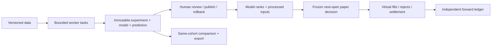

# Qlib research workbench

[简体中文](qlib-guide.zh-CN.md)

PanWatch replaces its heuristic stock-ranking engine with an isolated Qlib
research pipeline. Qlib is a research framework, not a data subscription or a
guarantee of returns. This integration is not an endorsement by Microsoft.

## Runtime

The API and worker use separate dependencies. The worker targets Python 3.12,
pyqlib 0.9.7, pandas 2.2.3, NumPy 2.2.6, LightGBM 4.6.0, scikit-learn 1.7.2 and
MLflow 2.22.0. The universal transitive lock contains package hashes in
`requirements-qlib.txt`. API dependencies are not downgraded.

```sh
bash scripts/setup_qlib.sh
```

macOS LightGBM also requires OpenMP (`brew install libomp`). The Dockerfile
builds a separate `/opt/qlib` environment and installs `libgomp1` in the runtime.
For a custom interpreter set `QLIB_WORKER_PYTHON` to an absolute executable path.
An unavailable or mismatched worker pauses new research without a legacy fallback.
Linux ARM64 requires `g++`: upstream 0.9.7 has no aarch64 PyPI wheel.
Setup/Docker uses the SHA256-pinned upstream release commit in
`requirements-qlib-arm64.txt`, locked Cython/NumPy/setuptools, and disabled build
isolation. Build tools stay out of the final Docker stage. See the
[upstream release source](https://github.com/microsoft/qlib/tree/da920b7f954f48ab1bb64117c976710de198373e)
and [distribution files](https://pypi.org/project/pyqlib/0.9.7/#files).

## Data contract

Upload **data-only JSON** from Opportunities → Data & runtime. Supply source,
declared license and permission acknowledgement, data kind (`market` or
`synthetic`), pool kind (`historical_membership` or `fixed_research`), adjustment
semantics (`point_in_time` or `snapshot_adjusted`), an explicit sorted unique
session `calendar`, membership intervals, and bars. Minimum: three instruments,
220 sessions / bars per instrument. Maximum: 200 membership intervals,
200,000 bars and 40 MB. No Python, YAML, model files or pickle upload.

Each membership has `symbol`, `start`, `end`, `price_limit: 0.1` and
`special_treatment: false`. Supported codes: SH600/601/603/605 and SZ000/001/002.
Each bar has `date`, `symbol`, unadjusted `open/high/low/close`, `volume` in shares
and a positive `factor` where adjusted price = raw price × factor. Do not pass
adjusted prices as raw execution prices. Membership changes and historically
revised adjustment factors must be represented honestly, not inferred from
today's index constituents. Historical sessions not in the bundled current-year
calendar rely on the explicit provider calendar; its source is part of the manifest.

Imports reject duplicates, nonfinite values, inconsistent OHLC, unsupported
boards, incomplete/future sessions and membership violations. Versions are
content-addressed. A later prediction snapshot may extend history but cannot
revise training bars, calendars or historical membership.

The application does **not** acquire or license a market-data feed. Daily updates
must be imported manually or through authenticated `POST /api/qlib/datasets`, then
selected in the schedule. Stale snapshots block scheduled work. Provider license
and point-in-time declarations are not independently certified by PanWatch.

From a source checkout, this optional fixture creates **synthetic QA-only** data:

```sh
python -m tests.qlib_fixture --output /tmp/panwatch-synthetic-new.json
```

The destination must not exist. Never present its performance as market evidence.

## Workflow and boundaries



1. Import data. Choose Alpha158 + LightGBM or the Ridge challenger, target horizon,
   Top-K, fees and publication gates. Save reusable configurations.
2. Run a background job; inspect its status or cancel. A request key is idempotent.
   Interrupted jobs fail explicitly; partial files never become publishable models.
3. Inspect held-out RankIC, cost-adjusted portfolio performance, momentum baseline
   and three expanding-window folds. Feature processors fit on training data only;
   train/validation/test boundaries purge the label horizon. Test labels that have
   not matured are excluded. Overlapping horizons are not independent trials.
4. Compare experiments only when data, splits, target and execution settings match.
   Export metadata/results/configuration, not licensed bars or serialized models.
5. Publish with a reason and a revision check. **Research mode** permits explicit
   engineering exploration. **Validated mode** checks declared market/PIT/historical
   membership data, pre-specified IC/sample/drawdown gates, momentum comparison and
   all three rolling gates. This is not a promise of future alpha. Rollback selects
   previously reviewed Qlib models only. Retirement preserves history but disallows
   prediction/publication; switch the active model before retiring it.
6. Inspect immutable raw scores and rank percentiles. Neither is a probability or
   a calibrated expected return. Ties use stable instrument ordering. The displayed
   factor snapshot contains processed inputs, not SHAP or causal contributions.
   The research basket does not alter the training pool or ranking.
7. Explicitly acknowledge research limitations to create a paper decision. Execution
   uses the next **known** CN session, within 09:30–09:35, a virtual opening price,
   100-share lots, the frozen aggregate fee settings and T+1. Invalid/stale opening
   quotes, suspension, price limits, legacy holdings and insufficient cash reject
   fills. One decision executes at most once. Quotes with only a source date cannot
   establish tick-level timeliness; no order-book matching or impact model is claimed.

TopkDropout uses `n_drop=topk`, keeps eligible winners and distributes 90% of
available cash across entrants; it does not resize surviving holdings daily.
Indicative weights are not fill promises. Backtest and forward execution share
the policy and aggregate fees, but historical daily-bar availability, opening-window
quote delivery, funding allocations and manual exits can produce differences.
Cash is the backtest reference, not index excess return. Historical and forward
equity are never spliced together. Broker live trading is not supported.

## Ongoing governance

Scheduling is opt-in. Completed snapshots drive daily reviewed-model predictions
and an independent training queue. Retraining creates candidates; a challenger is
shadow-only. Failures get at most three attempts per dataset/model/day; cancellation is
not retried automatically. Health reports freshness, coverage, input z-magnitude,
Top-K changes and recent failures. Input drift is a diagnostic proxy, never an
automatic reason to optimize or publish. Prediction reconstructs the model from
frozen data/config; a replay fingerprint must match before accepting its output.

Single-process API deployment is the supported execution topology. No distributed
trainer, arbitrary code execution, GPU models, finance/event features, multi-market
selection, automatic tuning or broker integrations are included.

Forward monitoring separates current-model realized/unrealized net P&L from
historical backtests. Qlib exposure includes holdings from all model versions,
divided by total ledger equity; legacy holdings are excluded from the numerator.
These ledger observations are not a model return series.

## Upgrade

Back up the database first. Migration 139 drops only the 14 old selection-derived
tables; historical migration definitions remain for deterministic upgrades.
Old recommendation/factor endpoints, score bonuses, scanners and Agent-to-paper
bridges are removed. Accounts, holdings, trades, settlements and analysis reports
remain. Legacy paper positions are marked independently and can be closed manually,
but are never automatically transferred to the Qlib model.
