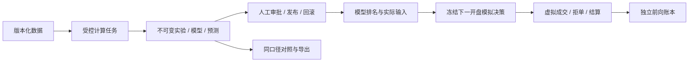

# Qlib 研究工作台

[English](qlib-guide.md)

PanWatch 用隔离的 Qlib 研究链路替换手工加分选股。Qlib 不提供数据授权，也不保证收益；本项目不声称微软官方背书。

## 安装与数据

API 与 worker 的依赖隔离。worker 使用 Python 3.12、pyqlib 0.9.7、pandas 2.2.3、NumPy 2.2.6、LightGBM 4.6.0、scikit-learn 1.7.2、MLflow 2.22.0；完整跨平台依赖和哈希在 `requirements-qlib.txt`。

```sh
bash scripts/setup_qlib.sh
```

macOS 还需 `brew install libomp`。Docker 内置独立 `/opt/qlib` 环境与 `libgomp1`。自定义解释器使用绝对路径配置 `QLIB_WORKER_PYTHON`；环境缺失或版本不匹配时暂停新研究，不回退旧评分。

机会页直接提供完整三市场研究池；高级数据页仍支持其他已授权的 data-only JSON。JSON 至少包含 3 个标的、每股 220 条行情及 220 个已完成交易日，最多 512 个成分区间、200,000 行和 40MB。必填来源、许可及确认、market、data_kind、universe_kind、adjustment、排序唯一的 calendar、members 和 bars。不接受代码、YAML 或模型文件。

证券统一标识为 SH/SZ/BJ 加 6 位代码、HK_ 加 5 位代码、US_ 加交易代码（如 US_BRK.B）。members 声明 start/end、price_limit、special_treatment、lot 和 currency；港股必须提供交易所板手，美股默认 1 股，港美股 price_limit=null，不套用 A 股涨跌停。bars 是未复权 OHLC、股数 volume 和正 factor。复权价=原价×factor，不得把复权价当成虚拟执行原价。

### 初始化完整研究母池（无需手工 JSON）

机会页 → **初始化完整研究池** → 填写已有数据使用依据并确认 → 获取三个完整目录。A 股包括主板、创业板、科创板、北交所；港交所股票（双柜台按证券代码分别计数）；NASDAQ、NYSE、NYSE American 普通股及 ADR。ETF、基金、权证、OTC、退市证券不纳入。A 股校验总数及全部分页；港交所读取实际 XML 行，不依赖错误的表格 dimension；美国校验两份目录的完成尾标，结合 ETF/Test 标志及证券描述分类。未知代码或分类限制明确记录，不以示例股票兜底。

切换市场 → **同步本市场全部日线**。复用已启用的腾讯/东财（CN）及 Yahoo（HK/US）K 线源；Yahoo 未开启时先前往数据源设置，程序不会擅自启用。Yahoo 使用既有 proxy 配置。母池全部可分页搜索，包括未同步和不可预测的股票；目录数量、最新数据就绪、最近预测、排除数量分开显示，不把目录收录当成行情覆盖。

历史数据按股票写入不可变内容哈希文件；进度/游标落库，任务可取消并继续，重启标为 interrupted。恢复时校验源配置、目录和已收盘日期，发生变化需新开同步；连续上游不可达停止并保留可恢复位置，不把全市场故障伪装成个股排除。至少 220 条且覆盖最新收盘日才就绪；短历史、停牌/陈旧、缺失、币种不符和历史修订保留具体原因。已有版本只追加，历史修订不覆盖冻结模型。

数据就绪 → **训练本市场候选** → 检查基线、样本外测试和三个滚动窗口 → **审核本市场模型** → 全部就绪股票预测。默认 128（可设 3–256）是确定性板块/交易所分层训练预算，用来控制内存，**不是母池或预测上限**。同一市场的所有就绪股票使用同一个已审核模型和训练段拟合的处理参数，按 64 只分批推断、全局统一排名；训练样本排名不会冒充全市场结果。调整训练预算不更改股票目录。三个市场分别审批、保留模型和排名，不混比原始模型分。

CN 因子为同源 hfq close/raw close 比值代理，保留原始日内比例；腾讯科创板量为股，其他腾讯股票和东财量为手，统一为股。HK/US 为同源 adjclose/provider quote close 快照比值，量为股。日历来自对应市场实际指数日线，按本地时区及已知提前收盘边界排除未完成日。当前目录、当前 lot/涨跌停规则和快照复权不是无幸存者偏差历史成分或 PIT 认证；CN 科创/北交所交易规则也只是保守研究近似，港股回测以单一主币种训练样本为单位，不混合币种资本。

港美股行情明确标为 `price_basis=provider_snapshot`：Yahoo 的历史 quote close 可能已拆股调整，adjclose/quote-close 是供应商快照比值，不能认证为拆股前真实执行价。现金、交易手数和公司行动回测只是研究代理，不能作为历史真实成交或正式模拟验证。正式发布及模拟执行均拦截这类价格。[供应商适配器原始说明](https://github.com/ranaroussi/yfinance/blob/main/doc/source/advanced/price_repair.rst) 提醒拆股、币种和缺失调整异常；这里不静默猜测修复或补造价格。

勾选自动同步后，按各市场最近已收盘日同步及预测；不会自动训练、审批、切换或下单。失败/主动取消需明确恢复，不无限自动重试。公开接口可访问不等于商用或再分发许可。三市场研究能力不等于三市场交易能力：港美股及不受支持的 A 股证券均不能创建现有模拟决策；本版模拟执行仍限普通 A 股主板。

源码环境可生成明确标注的工程样例，输出路径必须不存在：

```sh
python -m tests.qlib_fixture --output /tmp/panwatch-synthetic-new.json
```

该样例是合成数据，收益不能当成真实市场证据。

Linux ARM64 没有 Qlib 0.9.7 的 PyPI wheel，需安装 `g++`。安装脚本和 Docker
使用 `requirements-qlib-arm64.txt` 中带 SHA256 的官方发布 commit，固定
Cython/NumPy/setuptools 并关闭构建隔离，不临时下载未锁定构建依赖。
构建工具不进入最终 Docker 层。参见 [官方发布源码](https://github.com/microsoft/qlib/tree/da920b7f954f48ab1bb64117c976710de198373e)
和 [发布包清单](https://pypi.org/project/pyqlib/0.9.7/#files)。

## 用户流程

日常入口 `/opportunities` 恢复概览、筛选和双列股票卡片。排名前 10%/20%
按完整冻结研究池的名次计算，不是胜率；参考价格是对应日期的历史收盘价，不是实时价。
正式数据可以按自选及真实持仓筛选，点击卡片打开共享个股详情；其行情和解读不参与 Qlib 排名。
合成样例不关联真实公司或持仓，点击显示样例详情，关注只保存到研究篮子。
“刷新”只回读结果，不隐式训练、预测或下单。没有结果时按提示进入高级设置。

训练、数据、回测、审批和审计集中在 `/research`（量化研究），也可从导航的更多菜单进入。
“查看模型组合”打开 `/research?tab=paper`，模拟决策仍需在高级模型机会中明确确认。
真实与模拟持仓不混用。当前没有买入区间、止损或目标价输出，不用假字段补齐旧卡片。



1. 选择 Alpha158 + LightGBM 或 Ridge 候选；事先保存预测期限、Top-K、费用和发布门槛，可复用配置。
2. 异步训练、回测或取消；请求幂等。重启导致中断的任务显式失败，部分文件不成为可发布产物。
3. 查看样本外 RankIC、成本后回测、20 日动量基线及 3 个独立扩展窗口。处理参数只在训练段拟合，区间边界隔离标签期限，未成熟测试标签不统计；重叠期限不是独立试验。
4. 同一数据、分段、目标和执行配置才可比较。导出结果、配置和元数据，不导出许可行情或序列化模型。
5. 以理由和版本修订号审批。研究模式用于明确的工程探索；通过预注册门槛的模式要求声明为市场/历史成分/时点复权的数据、主测试及 3 个滚动窗口满足 IC/样本/回撤条件，并通过动量对照。不能由此保证未来 alpha。回滚只切换曾审批的 Qlib 版本。退役保留产物但禁止预测/发布；退役当前模型前必须先切换版本。
6. 原始分与排名百分位不是胜率或收益概率，并列按稳定证券顺序展示；输入快照是处理后的真实特征，不是 SHAP、因果贡献或 Agent 解读。研究篮子不修改母池或排序。
7. 明确确认研究限制后才能创建模拟决策。下一已知 A 股交易日 09:30–09:35 使用开盘价**虚拟**成交，100 股整数手、冻结的聚合费用及 T+1。过期/无效开盘报价、停牌、涨跌停、旧持仓冲突和资金不足会拒单；同一决策只执行一次。只带日期的报价不能证明逐笔时效，本版本不模拟盘口撮合或冲击。

组合为 TopkDropout、n_drop=topk：保留可交易的赢家，新增标的等分 90% 可用现金；不每日重配存量仓位。参考目标权重不是成交保证。回测与前向模拟共享规则和聚合费用，但历史日频可用性、开盘窗口行情、账户资金分配和手动平仓仍会造成差异。现金参考不是指数超额；两条净值不拼接，暂不支持实盘券商。

## 持续运行与升级

调度默认关闭。完整快照驱动每日正式模型预测和独立训练队列，重训只产生候选，其他候选只做影子预测。同数据/模型/日期最多 3 次尝试，主动取消不自动重试。健康页展示时效、覆盖率、输入稳健 z 幅度、Top-K 更换比例、失败任务，以及当前模型净盈亏和 Qlib 持仓风险占比。前向盈亏是账本观测，不是模型收益率或历史回测曲线；漂移只是诊断，不自动优化/发布。预测按冻结配置和数据重构模型，必须通过重放指纹检查。

支持单进程 API，不含分布式训练、任意代码、GPU、财务/事件特征、自动调参或券商接入。

升级前备份数据库。迁移 139 删除 14 个旧选股派生表，保留历史迁移定义以保证升级确定性。旧推荐/因子接口、加分、扫描与 Agent 写模拟信号入口退役；账户、持仓、交易、结算和分析历史保留。旧模拟仓位只做独立估值及手动处置，不自动交给 Qlib。
