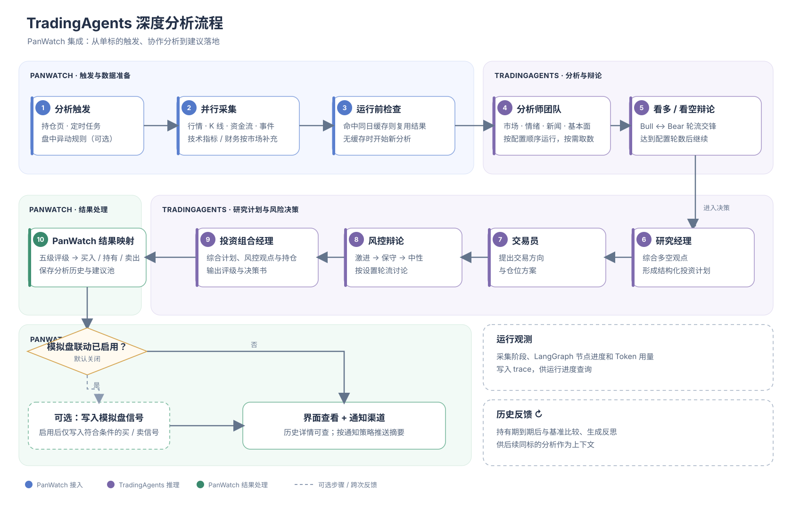

# TradingAgents 深度分析流程

[English](tradingagents-flow.en.md)

PanWatch 从持仓页、Agent 定时任务或已启用的盘中异动规则触发单标的分析。下图展示 PanWatch 的数据准备与结果处理，以及 TradingAgents 内部的多 Agent 决策流程。

当前锁定官方 v0.7.0，四类分析师并行执行，全部完成后进入研究辩论。研究辩论和风控讨论轮数均可配置。图中的模拟盘联动默认关闭；开启后，符合条件的买入或卖出建议才会写入模拟盘信号。TradingAgents 的评级会映射为 PanWatch 的买入、加仓、持有、减仓或卖出建议；无法解析的评级会标记为待人工复核。

新版最终评级以 `final_rating` 为准，研究主管结论来自 `investment_plan`。PanWatch 两层模型仍使用用户选定的同一 AI 服务；上游新增的 ChatGPT 订阅登录入口不在本次 UI 接入范围。

TradingAgents 会单独保存决策日志；按决策日后首个收盘价计入持有期；持有期结束且行情数据可用后，会将相对基准的表现和反思带入后续同标的分析。PanWatch 的分析历史和建议池用于展示结果，与这份上游决策日志分开保存。

## 相关实现

- [TradingAgentsAgent：采集、缓存与上游图调用](../src/modules/automation/tradingagents/agent.py)
- [PanWatch 数据上下文与持仓转换](../src/modules/automation/tradingagents/data_context.py)
- [PanWatch 行情工具适配](../src/modules/automation/tradingagents/toolkit_adapter.py)
- [决策评级映射与模拟盘信号桥接](../src/modules/automation/tradingagents/decision.py)
- [TradingAgents 上游多 Agent 流程（PanWatch 当前依赖 v0.7.0）](https://github.com/TauricResearch/TradingAgents/blob/v0.7.0/tradingagents/graph/setup.py)
