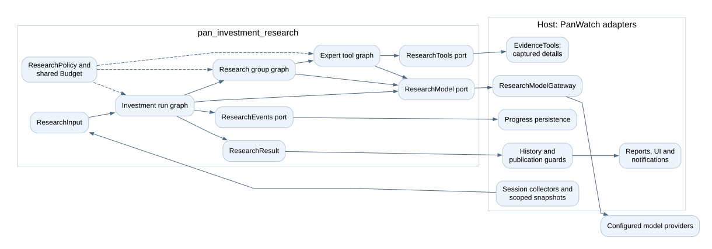
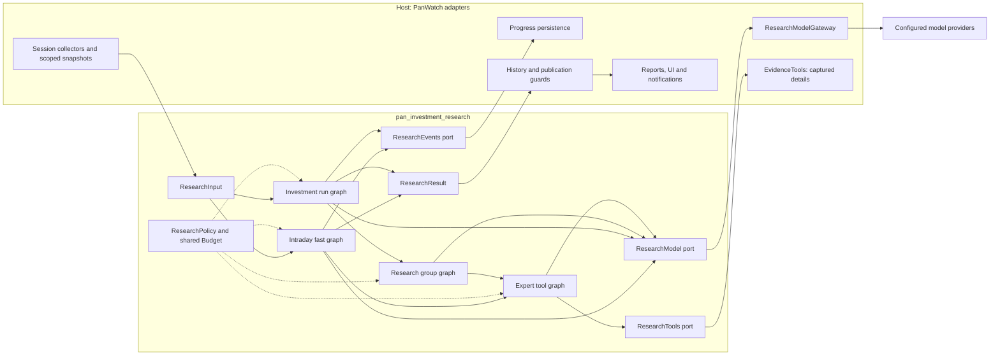
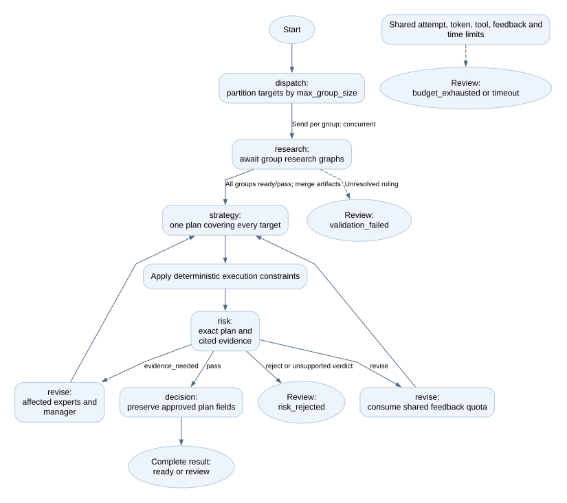
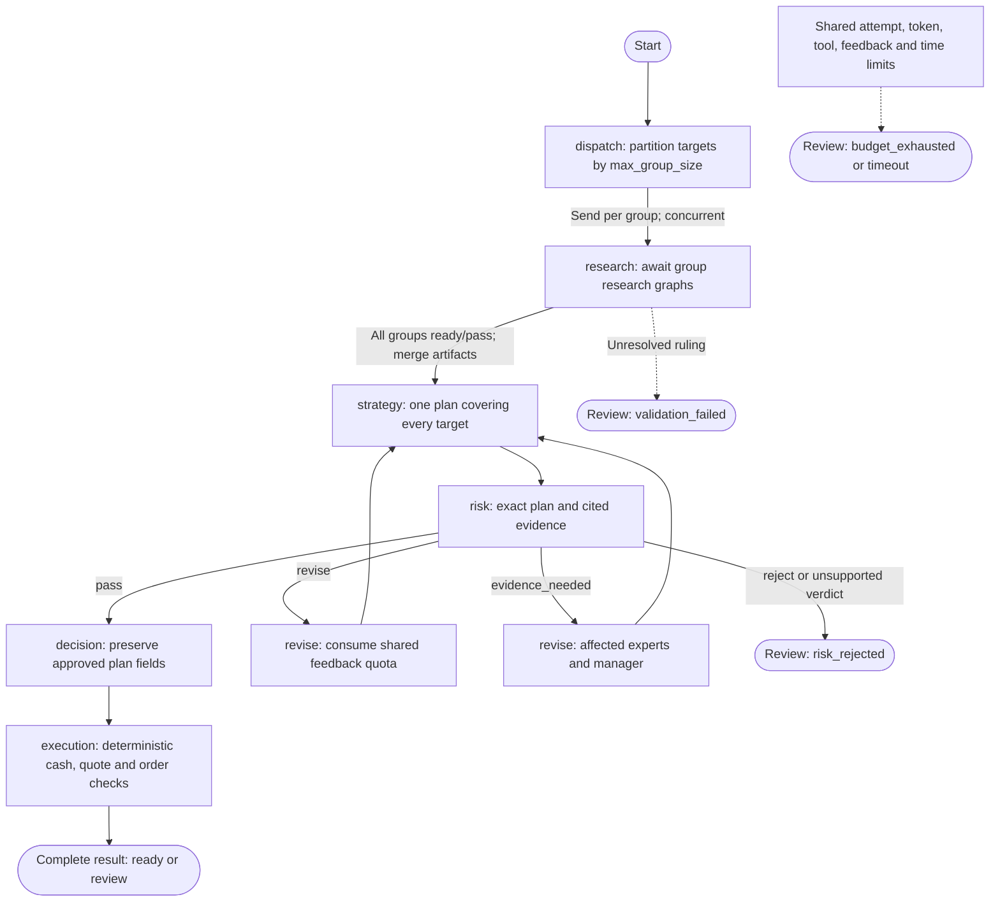
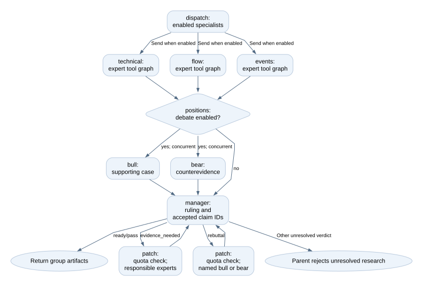
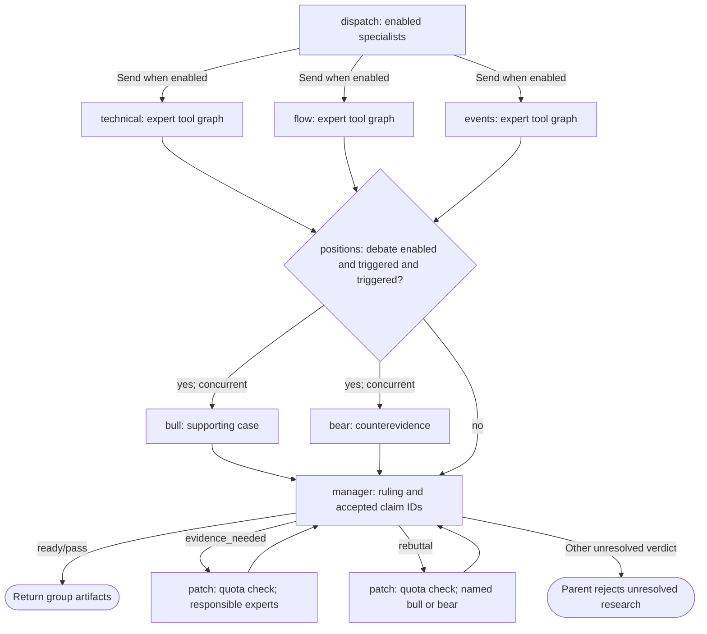
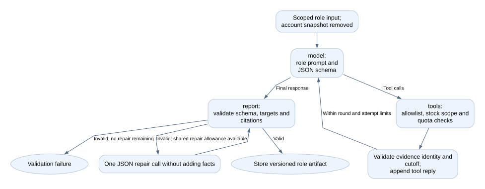
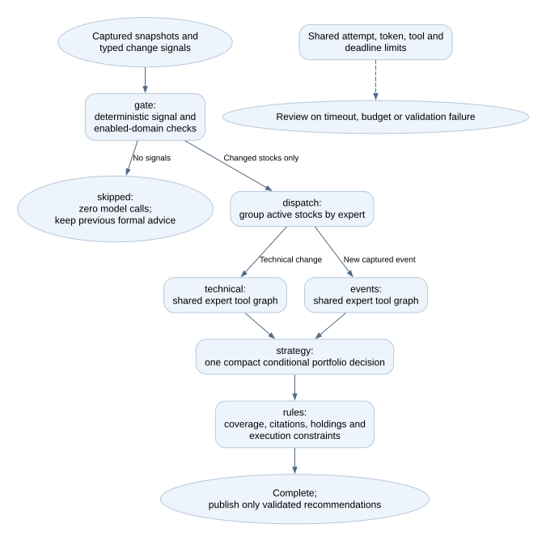
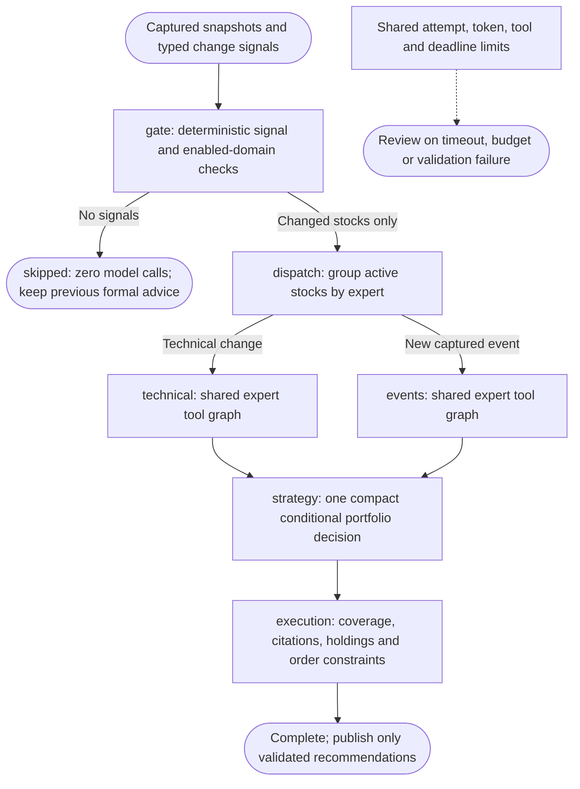

# Pan Investment Research

[简体中文](README.zh-CN.md)

A standalone Python package for bounded, multi-agent investment research using
LangGraph. Inspired by TradingAgents, it combines three specialist analysts,
supporting/opposing researchers, a research manager, a strategist, a risk
challenger and a final decision role. Roles can share one configured model.

## Package boundary

The package depends on Pydantic and LangGraph. It does not import PanWatch, open
a database, select credentials, send notifications or place orders. The host
supplies a model port, optional read-only tools and an event sink. It receives
typed recommendations and immutable, versioned research artifacts.

Four compiled graphs separate full investment decisions, group research, expert
tool loops and fast intraday decisions. Specialists run concurrently; each worker returns only after its
child graph finishes. A material dispute can request targeted evidence or a
rebuttal. Risk can return a plan for revision. All feedback shares one quota.

## Architecture

These diagrams describe the implemented control flow, not the execution trace of
every run. Arrows across the package boundary are injected port calls or returned
values; the package does not import the host adapters.



<details>
<summary>Mermaid source (editable control-flow specification)</summary>



</details>

`Dependencies` in `Runtime.context` holds each run's ports, policy, budget and
artifacts. Compiled graphs are reusable; mutable run state is not shared between
requests. The shared budget covers all groups, tools, model fallbacks, repairs
and feedback. All graphs can emit progress through the optional event port.
PanWatch's current tools read longer captured evidence, without fetching fresh
market data during research.

### 1. Investment run: combine all stock groups



<details>
<summary>Mermaid source (editable control-flow specification)</summary>



</details>

Each `research` worker awaits its child graph before joining the portfolio stage.
Strategy, risk and decision run once for the combined portfolio. The two revision
boxes describe branches inside the single `revise` node. An evidence patch
revisits only affected groups/domains and their manager; a plan-only revision
does not repeat the full specialist/debate sequence. An unfinished graph cannot
publish formal suggestions. A complete graph can still require human review.

### 2. Research group: specialists and adjudication



<details>
<summary>Mermaid source (editable control-flow specification)</summary>



</details>

The specialist boxes invoke the same `expert` worker with different role state.
Bull and bear are concurrent calls inside `positions`, not an unbounded
conversation. The two patch boxes are branches inside `patch`: targeted work
returns directly to the manager without restarting all specialists or both
opposing views. These feedback paths share the run-wide feedback quota.

### 3. Expert: bounded read-only tool loop



<details>
<summary>Mermaid source (editable control-flow specification)</summary>


</details>

Every provider send acquires an attempt permit. Tool rounds and total tool calls
are bounded; a tool cannot expand the scope or invent fresh evidence. JSON
repair consumes model attempts and the single run-wide repair allowance,
separately from the feedback counter. Failed validation exits to the run wrapper.

### 4. Fast intraday graph: changes, scoped experts and one decision



<details>
<summary>Mermaid source (editable control-flow specification)</summary>



</details>

The host captures quotes/news and detects ATR/volume/technical-state/position-risk
changes and new dated events. It persists a market-scoped baseline only after a
successful or skipped run; failed research can retry the same change. Quiet runs
still collect data but skip expensive historical enrichment and all model calls.
Only changed stocks and the corresponding enabled specialists reach the model.
When an active CN stock is admitted, a cached-per-run index snapshot also supplies market context. The final rule node is mandatory and makes no model call. This template omits the
research manager, bull/bear and model risk committee, so it offers less independent
challenge than the complete graph. Missing data is not classified as unchanged.

### Session templates and efficiency

PanWatch selects these presets; setting `profile` alone in the standalone package
does not apply host templates.

| Host template | Specialists | Bull/bear | Attempt / deadline defaults | Other defaults |
| --- | --- | --- | --- | --- |
| `postmarket_deep` | technical, flow, events | Material event or expert request | 18 / 180s | Full graph, bounded feedback |
| `premarket_balanced` | technical, flow, events | Material event or expert request | 14 / 90s | Full graph, 4 tools, 3072 output tokens |
| `intraday_fast` | Triggered technical/events only | Omitted | 6 / 45s | 2 tools, concurrency 2, no feedback, 1536 output tokens |
| `custom_research` | Selected specialists | Off, material-only or always | Session defaults | Complete graph retained for comparison |

The agent research dialog discovers templates from the backend and configures
specialists, debate/trigger policy, attempts, deadline and advanced token/tool/
concurrency/feedback limits. Switching templates restores its defaults. Backend
validation rejects unsupported specialists, arbitrary nodes/edges, fast debate
and feedback. Required rule checks cannot be disabled. `changes` is the normal
fast trigger; `always` explicitly reviews every selected target and expert.

All three PanWatch session agents now use LangGraph. Migration v139 changes stored
legacy/shadow engine settings to langgraph, preserving other settings, budgets,
bindings and historical records. New legacy/shadow configurations are rejected;
their execution branches, three prompt files and loose text parsers are removed.
Older explicit full-graph intraday settings still retain that graph. Host scope
sizing can raise omitted default capacities; explicit whole-run caps are never
raised, and deadlines are not extended.

Without tools, retries, repair or feedback, the full graph uses
`G × (S + 1) + 2 × B + 3` model calls: `G` groups, `S` specialists per group,
`B` groups that actually debate. A single group with three experts takes seven
calls, or nine with debate. The fast graph uses one call per active expert/group
plus one combined decision: zero when quiet, two for one domain in one group,
three for both domains in one group. More groups, detail tools and repair add
calls. These counts are not latency or cost guarantees.

### Prompt ownership and migrated rules

The shared `prompts.py` role/session instructions are the sole prompt source for
these three sessions. Historical legacy and shadow records remain readable; they
are not executable engine choices. Other agents, including TradingAgents deep
analysis and onboarding first analysis, keep their own execution paths.

The graph reuses collectors, not the old `build_prompt()` narrative. Useful rules
are explicitly migrated, rather than copying a whole single-agent prompt:

| Business rule | New location |
| --- | --- |
| ATR threshold and volume/technical changes | Host deterministic signal gate and technical evidence |
| Trading style, stop-loss/take-profit warnings | Position-scoped gate rules and strategy context |
| Relative strength and dated prior research | Captured technical context; historical hypotheses, not current facts |
| RSI/KDJ/Bollinger, flow divergence, event timing | Domain instructions in `prompts.py` |
| Premarket scenarios, postmarket review, intraday changes | Session instructions in `prompts.py` |
| Evidence references, holding/action consistency, buying power | Mandatory validation and execution constraints |
| Market/stocks/risks/next-session focus sections | Host report renderer |

The three old session prompt files have been deleted. There is no arbitrary runtime
prompt injection, graph editor or single-prompt fallback. Historical comparison can
use archived artifacts or a prior Git revision. Scripted replay verifies contracts
and call reductions, not improved investment accuracy or profitability.

### Source map

| File | Responsibility |
| --- | --- |
| [contracts.py](src/pan_investment_research/contracts.py) | Inputs, evidence, reports, recommendations, policy and results |
| [engine.py](src/pan_investment_research/engine.py) | Full graphs, feedback, validation and execution constraints |
| [fast.py](src/pan_investment_research/fast.py) | Fast signal gate, scoped experts, one proposal and mandatory rules |
| [prompts.py](src/pan_investment_research/prompts.py) | Shared role instructions and migrated session guidance |
| [budget.py](src/pan_investment_research/budget.py) | Shared attempt/token/tool/feedback accounting and concurrency |
| [ports.py](src/pan_investment_research/ports.py) | Model, optional read-only tool and optional event protocols |
| [tests/test_research.py](tests/test_research.py) | Scripted-model contract and graph regression scenarios |

## Install and use

```sh
python -m pip install ./packages/pan-investment-research
python -m pytest packages/pan-investment-research/tests -q
```

```python
from pan_investment_research import InvestmentResearch, ResearchInput, ResearchPolicy, ResearchSignal

result = await InvestmentResearch().run(
    ResearchInput.model_validate(prepared_input),
    model=my_model_adapter,
    tools=my_read_only_tools,
    events=my_event_sink,
    policy=ResearchPolicy(),
)
```

For a host-prepared intraday input with `ResearchSignal` entries:

```python
policy = ResearchPolicy(
    profile="intraday", graph="intraday_fast", specialists=["technical", "events"],
    debate=False, max_feedback=0, max_attempts=6, max_tools=2, deadline_seconds=45,
)
# prepared.signals = [ResearchSignal(stock_key="CN:600519", domain="technical",
#     reasons=["atr_price_change"], observed_at=prepared.as_of)]
result = await InvestmentResearch().run(prepared, model=my_model_adapter, policy=policy)
```

See `ResearchModel`, `ResearchTools` and `ResearchEvents` in `ports.py`.
**Every provider attempt, including fallbacks and retries, must await the
supplied `before_attempt` callback immediately before sending.** Model SDK
automatic retries must be disabled. The adapter returns usage from that exact
response, not shared mutable counters. Missing or uncertain usage stays unknown.

Inputs use `market:symbol` keys and timezone-aware timestamps. Evidence cannot
cross the research scope or arrive after the declared analysis cutoff. Model
claims must cite visible evidence. Tools are allowlisted per specialist, may
only return scoped evidence, and cannot change an existing evidence identity.
Documents are treated as data, never as agent instructions.

## Limits and results

One full research group with three experts and debate needs nine logical calls
before tools, repair and feedback (seven without debate). Multiple groups need separate budgets; strategy/risk/decision run once
for the combined portfolio. Request attempts, estimated token reservations,
tool calls, feedback, concurrency, output size and time are bounded. Estimated
tokens are conservative preflight accounting, not measured billing.

`ready` means the produced plan passed the package's implemented checks. It is
not a promise of profitability, complete exchange-rule validation or executable
buying power. Missing settlement/currency facts cannot authorize quantities.
The final decision cannot change the risk-approved plan. An unresolved objection
or exhausted budget returns `review` with a distinct `completion` reason. No watch
recommendation is invented: validated strategy views remain blocked drafts, or the
recommendation list is empty if no strategy finished.
Infrastructure exceptions propagate to the host; cancellation is not swallowed.

The host owns fresh account/market constraints, persistence, idempotent delivery,
notification policy and durable recovery. Checkpoint recovery is not enabled by
default. Package tests use scripted models and replay evidence; they do not
demonstrate live model quality or trading returns.

## Research and execution are separate

Each recommendation carries an evidence-based `outlook` (`bullish`, `neutral`,
`bearish`), model confidence from 0 to 1, a conditional portfolio `action`, and
`execution_status` / `execution_constraints`. Confidence is not calibrated return
probability. Zero cash, unverified buying power, stale quotes and human review
block execution without rewriting a supported outlook or buy opportunity to watch.
No model role receives account cash, buying power or raw portfolio records.
Only position presence reaches the proposal model; market evidence contains dated
ratings, not recycled account-restricted report bodies. Strategy/risk/decision
complete a market plan before the mandatory `execution` rule node applies cash,
quote age, sellable quantity and review restrictions. Model-authored quantities,
account constraints and explicit cash-based recommendation rationales are rejected.

Premarket strategy must produce evidence-linked `session_notes` for every stock,
with upside/downside conditional responses. Postmarket notes attribute observed
moves and evaluate only a supplied same-day, same-market premarket `prior_plan`.
Without one, `prior_verdict=no_prior` is required; pending triggers are not wins.
These notes reuse the strategy call and add no model role.

`completion=skipped` means no enabled change triggered fast research: no formal
advice, predictions or notification should be written, and previous advice stays.
The audit includes a deterministic gate artifact and zero attempts.

`completion=complete` distinguishes a finished graph from timeout, budget exhaustion,
validation failure and risk rejection. A complete graph may still require human
review. Drafts from incomplete graphs must not enter formal suggestions or prediction
statistics. Version 0.2 requires outlook and confidence; older stored reports remain
readable in the host without fabricating missing fields. No result authorizes an order.
