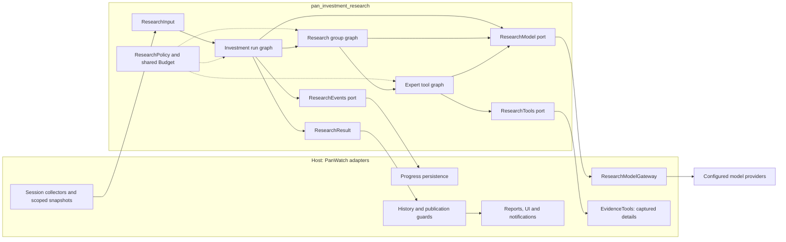
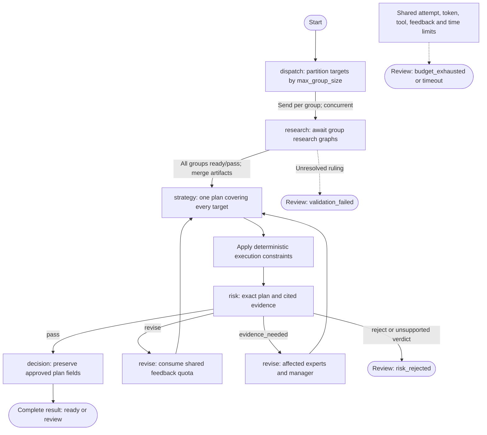
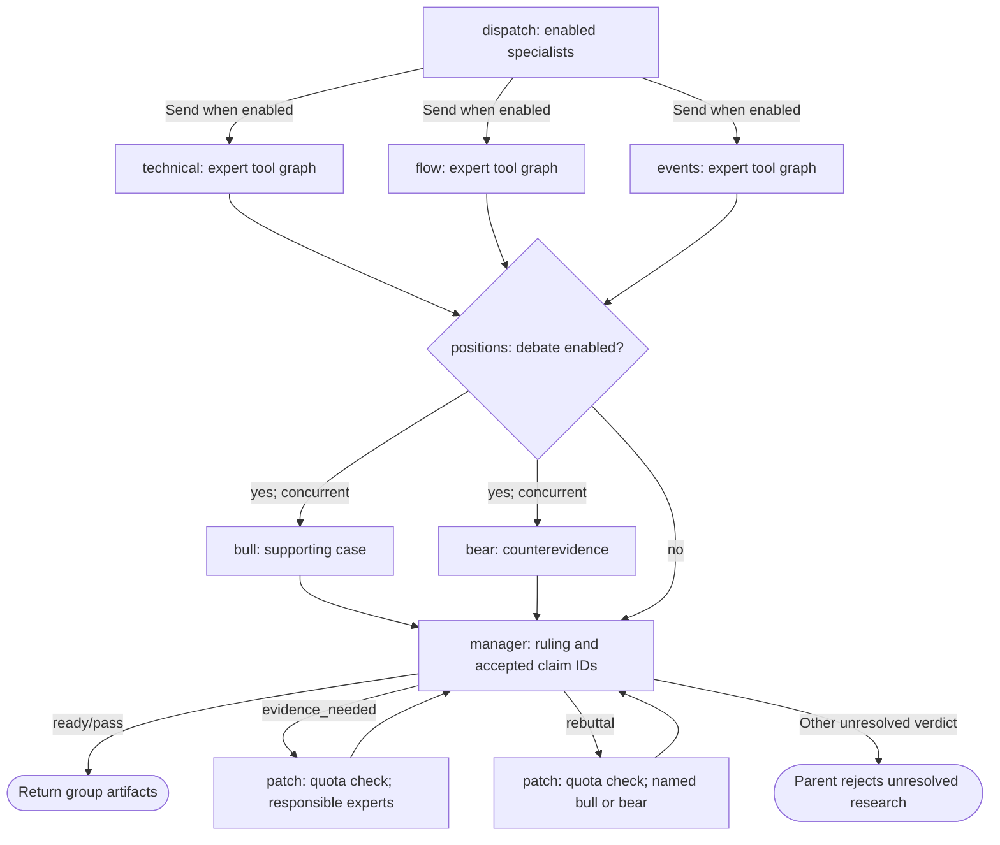
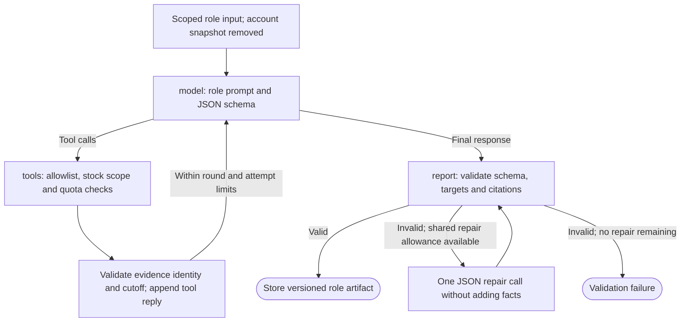

# Pan Investment Research

[简体中文](README.zh-CN.md)

A standalone Python package for bounded, multi-agent investment research using
LangGraph. Inspired by TradingAgents, it combines three specialist analysts,
supporting/opposing researchers, a research manager, a strategist, a risk
challenger and a final decision role. Roles can share one configured model.

## Package boundary

The package depends on Pydantic and LangGraph. It does not import PanWatch, open
a database, select credentials, send notifications or place orders. The host
supplies a model port, optional read-only tools and an event sink. It receives
typed recommendations and immutable, versioned research artifacts.

Three compiled graphs separate investment decisions, group research and expert
tool loops. Specialists run concurrently; each worker returns only after its
child graph finishes. A material dispute can request targeted evidence or a
rebuttal. Risk can return a plan for revision. All feedback shares one quota.

## Architecture

These diagrams describe the implemented control flow, not the execution trace of
every run. Arrows across the package boundary are injected port calls or returned
values; the package does not import the host adapters.


<details>
<summary>Mermaid source (editable control-flow specification)</summary>



</details>

`Dependencies` in `Runtime.context` holds each run's ports, policy, budget and
artifacts. Compiled graphs are reusable; mutable run state is not shared between
requests. The shared budget covers all groups, tools, model fallbacks, repairs
and feedback. All graphs can emit progress through the optional event port.
PanWatch's current tools read longer captured evidence, without fetching fresh
market data during research.

### 1. Investment run: combine all stock groups


<details>
<summary>Mermaid source (editable control-flow specification)</summary>



</details>

Each `research` worker awaits its child graph before joining the portfolio stage.
Strategy, risk and decision run once for the combined portfolio. The two revision
boxes describe branches inside the single `revise` node. An evidence patch
revisits only affected groups/domains and their manager; a plan-only revision
does not repeat the full specialist/debate sequence. An unfinished graph cannot
publish formal suggestions. A complete graph can still require human review.

### 2. Research group: specialists and adjudication


<details>
<summary>Mermaid source (editable control-flow specification)</summary>



</details>

The specialist boxes invoke the same `expert` worker with different role state.
Bull and bear are concurrent calls inside `positions`, not an unbounded
conversation. The two patch boxes are branches inside `patch`: targeted work
returns directly to the manager without restarting all specialists or both
opposing views. These feedback paths share the run-wide feedback quota.

### 3. Expert: bounded read-only tool loop


<details>
<summary>Mermaid source (editable control-flow specification)</summary>



</details>

Every provider send acquires an attempt permit. Tool rounds and total tool calls
are bounded; a tool cannot expand the scope or invent fresh evidence. JSON
repair consumes model attempts and the single run-wide repair allowance,
separately from the feedback counter. Failed validation exits to the run wrapper.

### Session profiles and efficiency

PanWatch chooses these defaults in its adapter. Setting `profile` alone in the
standalone package does not automatically apply these presets.

| Host session | Initial specialists | Debate | Attempt / time defaults | Extra defaults |
| --- | --- | --- | --- | --- |
| Postmarket | technical, flow, events | On | 18 / 180s | Package defaults |
| Premarket | technical, flow, events | Off; on when captured event items exist | 14 / 90s | Explicit configuration supported |
| Intraday | technical; add events when captured event items exist | Off; on when event items exist | 10 / 45s | No feedback; 2 tool calls; concurrency 2 |

Explicit specialist/debate configuration overrides automatic selection. Host
scope sizing can raise default attempt/token/tool/output capacity for larger
inputs, but does not automatically extend the deadline. These limits are not
latency guarantees or proof that a given provider can finish in time.

Without tools, repairs or feedback, logical model calls are
`G × (S + 2 × D + 1) + 3`: group count `G`, specialist count `S`, and `D=1`
when debate is enabled, otherwise `0`. A full default single-group run needs
9 calls. Parallel specialists and bull/bear, optional debate, batched detail
tools, compact downstream inputs and targeted revisions reduce repeated work.
More roles do not by themselves prove better conclusions; source/model quality,
latency and cost need separate evaluation.

### Prompt ownership and legacy compatibility

| PanWatch mode | Prompts used | Published session output |
| --- | --- | --- |
| `legacy` (default) | Existing `prompts/daily_report.txt`, `premarket_outlook.txt`, `intraday_monitor.txt` | Existing agent analyze/render path |
| `shadow` | Role prompts for shadow research, then existing prompts for the legacy run | Legacy output; shadow artifacts kept for inspection |
| `langgraph` | `ROLES`, common instructions and per-role schema in `engine.py` | Structured graph result rendered by the host |

The graph reuses host collection, not legacy `build_prompt()` or its complete
input narrative. Legacy ATR/abnormal-move rules, trading-style guidance, relative
strength and previous deep-research instructions are **not automatically
inherited**. Useful business semantics need explicit migration into evidence,
contracts, role instructions or deterministic checks, followed by validation.
Report headings and layout belong to the host renderer. The standalone package
does not read PanWatch prompt files or currently offer runtime prompt-template
injection. Mode selection is explicit; graph failure is not an automatic legacy
retry.

### Source map

| File | Responsibility |
| --- | --- |
| [contracts.py](src/pan_investment_research/contracts.py) | Inputs, evidence, reports, recommendations, policy and results |
| [engine.py](src/pan_investment_research/engine.py) | Three graphs, role prompts, feedback, validation and execution constraints |
| [budget.py](src/pan_investment_research/budget.py) | Shared attempt/token/tool/feedback accounting and concurrency |
| [ports.py](src/pan_investment_research/ports.py) | Model, optional read-only tool and optional event protocols |
| [tests/test_research.py](tests/test_research.py) | Scripted-model contract and graph regression scenarios |

## Install and use

```sh
python -m pip install ./packages/pan-investment-research
python -m pytest packages/pan-investment-research/tests -q
```

```python
from pan_investment_research import InvestmentResearch, ResearchInput, ResearchPolicy

result = await InvestmentResearch().run(
    ResearchInput.model_validate(prepared_input),
    model=my_model_adapter,
    tools=my_read_only_tools,
    events=my_event_sink,
    policy=ResearchPolicy(),
)
```

See `ResearchModel`, `ResearchTools` and `ResearchEvents` in `ports.py`.
**Every provider attempt, including fallbacks and retries, must await the
supplied `before_attempt` callback immediately before sending.** Model SDK
automatic retries must be disabled. The adapter returns usage from that exact
response, not shared mutable counters. Missing or uncertain usage stays unknown.

Inputs use `market:symbol` keys and timezone-aware timestamps. Evidence cannot
cross the research scope or arrive after the declared analysis cutoff. Model
claims must cite visible evidence. Tools are allowlisted per specialist, may
only return scoped evidence, and cannot change an existing evidence identity.
Documents are treated as data, never as agent instructions.

## Limits and results

One complete research group needs nine logical calls before tools, repair and
feedback. Multiple groups need separate budgets; strategy/risk/decision run once
for the combined portfolio. Request attempts, estimated token reservations,
tool calls, feedback, concurrency, output size and time are bounded. Estimated
tokens are conservative preflight accounting, not measured billing.

`ready` means the produced plan passed the package's implemented checks. It is
not a promise of profitability, complete exchange-rule validation or executable
buying power. Missing settlement/currency facts cannot authorize quantities.
The final decision cannot change the risk-approved plan. An unresolved objection
or exhausted budget returns `review` with a distinct `completion` reason. No watch
recommendation is invented: validated strategy views remain blocked drafts, or the
recommendation list is empty if no strategy finished.
Infrastructure exceptions propagate to the host; cancellation is not swallowed.

The host owns fresh account/market constraints, persistence, idempotent delivery,
notification policy and durable recovery. Checkpoint recovery is not enabled by
default. Package tests use scripted models and replay evidence; they do not
demonstrate live model quality or trading returns.

## Research and execution are separate

Each recommendation carries an evidence-based `outlook` (`bullish`, `neutral`,
`bearish`), model confidence from 0 to 1, a conditional portfolio `action`, and
`execution_status` / `execution_constraints`. Confidence is not calibrated return
probability. Zero cash, unverified buying power, stale quotes and human review
block execution without rewriting a supported outlook or buy opportunity to watch.
Market specialists do not receive account snapshots. Verified account limits are
applied deterministically before risk review and finalization.

`completion=complete` distinguishes a finished graph from timeout, budget exhaustion,
validation failure and risk rejection. A complete graph may still require human
review. Drafts from incomplete graphs must not enter formal suggestions or prediction
statistics. Version 0.2 requires outlook and confidence; older stored reports remain
readable in the host without fabricating missing fields. No result authorizes an order.
