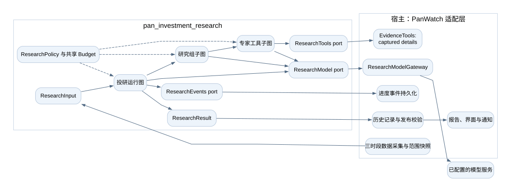
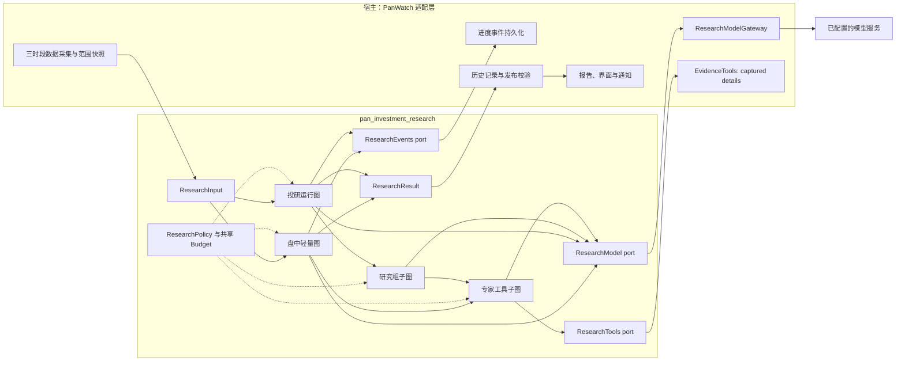
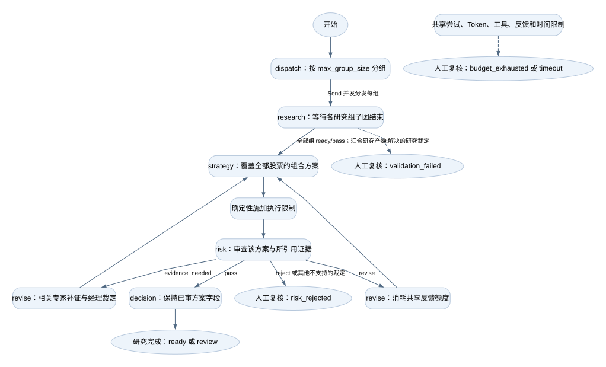
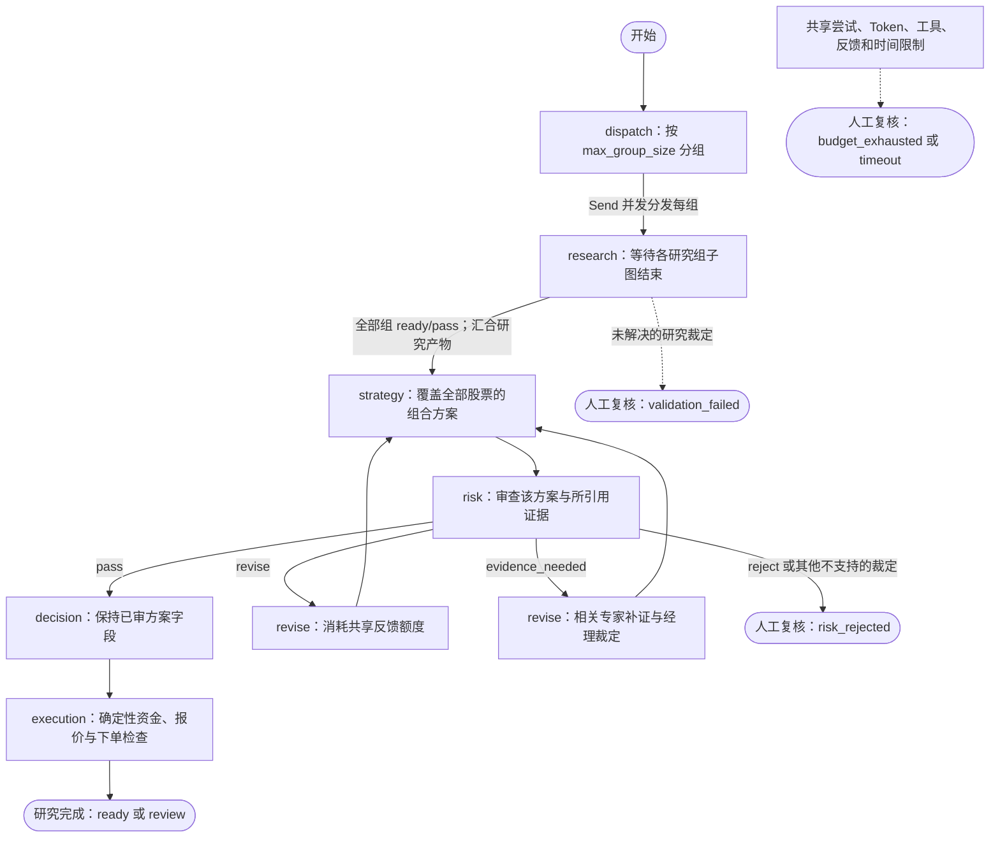
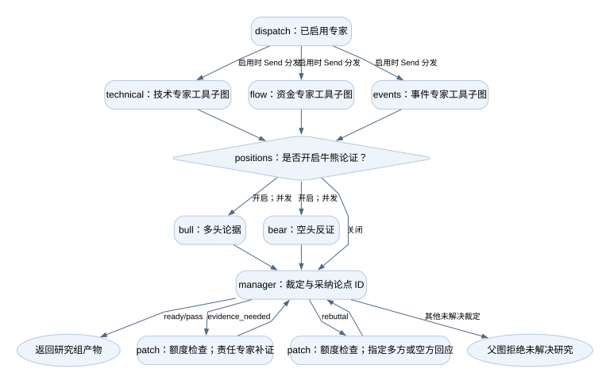
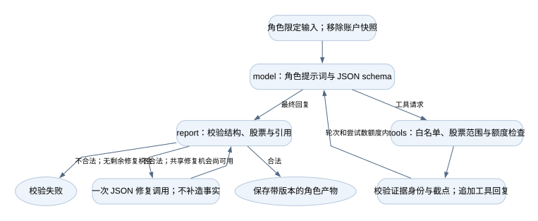
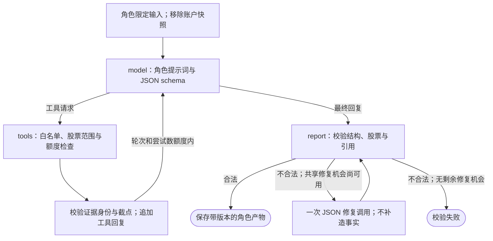
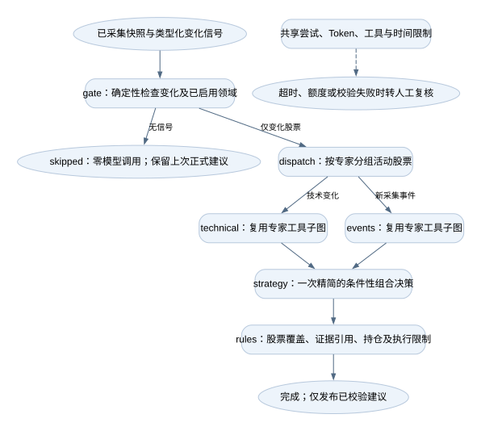
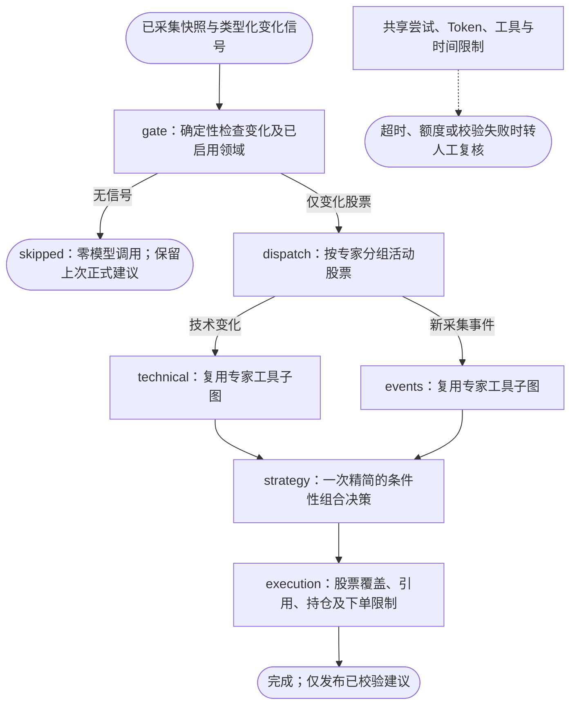

# Pan Investment Research

[English](README.md)

使用 LangGraph 的独立多 Agent 投研包。参考 TradingAgents，提供技术、资金、事件
三类专家，多方与空方研究员，以及研究经理、策略、风控挑战和最终决策角色。
角色可以共用同一个底层模型。

## 边界与接入

包只依赖 Pydantic 与 LangGraph，不导入 PanWatch，不读数据库或凭证，不发通知，
不下单。宿主注入模型、只读工具和事件接口，取得类型化建议及带版本的研究产物。

四张编译图分别负责完整组合决策、研究协作、专家工具回路和盘中轻量决策。
专家并行，子图完整结束后才参与父图汇合。关键争议可定向补证或回应，风控可退回
策略修改；这些反馈共用额度，不会无限循环。

## 设计与架构

以下图描述当前实现的控制流，不代表每次运行都执行全部节点。跨包边界的箭头表示
注入端口调用或返回值，投研包不反向导入宿主适配器。



<details>
<summary>Mermaid 源码（可维护的控制流说明）</summary>



</details>

每次运行的端口、策略、预算和产物放在 `Runtime.context` 的 `Dependencies` 中。
编译后的图可以复用，请求之间不共享可变运行状态。所有研究组、模型回退、工具、
修复和反馈使用同一份运行预算。各层都可通过可选事件端口记录进度。PanWatch 当前
工具只读取已采集证据的完整版本，不在研究中获取更新时点的行情或新闻。

### 1. 投研运行图：多股分组后统一决策



<details>
<summary>Mermaid 源码（可维护的控制流说明）</summary>



</details>

每个 `research` worker 等待子图完整结束后才参与父图汇合。组合策略、风控与最终
决策对全部股票统一执行一次。两个修订框表示同一 `revise` 节点的内部路径：补证
只重跑受影响研究组的责任专家及经理，纯方案修订不重跑完整专家和牛熊论证。
研究未完成不能发布正式建议；图已完成仍可能需要人工复核。

### 2. 研究组子图：专家、牛熊与经理裁定



<details>
<summary>Mermaid 源码（可维护的控制流说明）</summary>


</details>

三个专家框是同一 `expert` worker 按角色分别调用。牛熊是 `positions` 节点内部的
两次并发调用，不是无限辩论。两个补证／回应框是 `patch` 的内部路径：定向处理后
直接回经理，不重新执行全部专家，也不自动重跑双边论证。各反馈路径共享运行额度。

### 3. 专家工具子图：有限轮次的只读补证



<details>
<summary>Mermaid 源码（可维护的控制流说明）</summary>



</details>

每次模型实际发送都先申请尝试额度。工具轮次与调用总数受限，不能扩大股票范围、
补造证据或修改已有证据身份。JSON 修复消耗模型尝试数，并使用全运行共享的一次
修复机会，与反馈次数分别计数。校验失败交由运行入口返回对应的未完成状态。

### 4. 盘中轻量图：变化门控、定向专家与一次决策



<details>
<summary>Mermaid 源码（可维护的控制流说明）</summary>



</details>

宿主采集行情与新闻，确定性识别 ATR／成交量／技术状态／持仓风险变化及有时间的
新事件。仅在成功或跳过后保存按市场隔离的门控基线；研究失败时同一变化仍可重试。
无变化仍采集数据，但跳过昂贵的历史上下文补全和全部模型调用。仅变化股票及对应
的已启用专家进入模型。活动 A 股通过门控后，还会采集大盘指数，同轮按市场复用。最后的规则校验必经，且不调用模型。轻图省去研究经理、
牛熊和模型风控委员会，因此独立质疑深度低于完整图。数据缺失不等于没有变化。

### 时段模板与效率

PanWatch 宿主选择以下预设；独立包只设置 `profile` 不会自动套用宿主模板。

| 宿主模板 | 专家 | 牛熊论证 | 尝试数／时间默认上限 | 其他默认项 |
| --- | --- | --- | --- | --- |
| `postmarket_deep` | 技术、资金、事件 | 重大事件或专家请求时 | 18 / 180秒 | 完整图，有界反馈 |
| `premarket_balanced` | 技术、资金、事件 | 重大事件或专家请求时 | 14 / 90秒 | 完整图，4次工具，3072输出 Token |
| `intraday_fast` | 仅触发的技术／事件专家 | 省略 | 6 / 45秒 | 2次工具，并发2，无反馈，1536输出 Token |
| `custom_research` | 自选专家 | 关闭、重大争议、始终 | 沿用时段默认 | 保留完整图供对照 |

Agent 的研究配置弹窗从后端读取可用模板，可配置专家、论证／触发策略、尝试数、
时间，以及高级 Token／工具／并发／反馈限制。切换模板会恢复其默认值。后端拒绝
不支持的专家、任意节点／边、轻图牛熊与反馈配置；必经规则校验不能关闭。
轻图默认 `changes`；显式选择 `always` 会研究全部选中股票及专家。

PanWatch 三个时段统一使用 LangGraph。v139 迁移将现存 legacy／shadow 引擎配置改为
langgraph，保留其他设置、预算、股票绑定与历史记录。新配置不再接受旧引擎；旧执行
分支、三个 prompt 文件及宽松文本解析器已删除。盘中原先显式要求完整图的配置仍保留
该图。宿主可扩展未显式设置的默认容量；显式额度始终是整轮上限，不上调、不延长时间。

不含工具、重试、修复和反馈时，完整图模型调用数为
`G × (S + 1) + 2 × B + 3`：`G` 为研究组数，`S` 为每组专家数，`B` 为实际论证的组数。
单组三专家无论证为7次，开启论证为9次。轻图为每个活动专家／组一次，加一次统一
决策：无变化0次，单组单领域2次，单组双领域3次。多分组、详情工具和修复会增加
调用。这些计数不代表耗时或费用保证。

### 提示词归属与旧规则迁移

三个时段唯一的提示词来源是 `prompts.py` 的共享角色与时段指令。历史 legacy／shadow
记录继续可读，不能作为运行引擎选择。TradingAgents 深度分析、首次分析等其他 Agent
继续使用各自独立执行路径。

新图复用采集器，不复用旧 `build_prompt()` 的整段叙述。有用的规则明确迁移，
不把原单 Agent prompt 整段复制给多个角色：

| 业务规则 | 新归属 |
| --- | --- |
| ATR 阈值、量能及技术状态变化 | 宿主确定性门控与技术证据 |
| 交易风格、止损／止盈警示 | 持仓范围内的门控规则与策略上下文 |
| 相对强弱、历史深度投研 | 已采集技术上下文；历史假设不能当作当前事实 |
| RSI／KDJ／布林带、资金背离、事件时效 | `prompts.py` 的领域指令 |
| 盘前情景、收盘复盘、盘中变化 | `prompts.py` 的时段指令 |
| 引用、持仓与动作一致性、购买力 | 必经校验与执行限制 |
| 大盘／个股／风险／后续关注章节 | 宿主报告渲染器 |

三个旧时段 prompt 文件已删除；没有任意运行时提示词注入、图编辑器或单 prompt 兜底。
历史对照可使用归档产物或旧 Git 版本。脚本回放验证的是契约和
调用减少，不能证明真实投研准确率或收益提高。

### 源码索引

| 文件 | 职责 |
| --- | --- |
| [contracts.py](src/pan_investment_research/contracts.py) | 输入、证据、角色报告、建议、策略与结果契约 |
| [engine.py](src/pan_investment_research/engine.py) | 完整图、反馈、校验及执行限制 |
| [fast.py](src/pan_investment_research/fast.py) | 轻图门控、定向专家、一次方案与必经规则 |
| [prompts.py](src/pan_investment_research/prompts.py) | 共享角色指令与迁移的时段规则 |
| [budget.py](src/pan_investment_research/budget.py) | 共享尝试／Token／工具／反馈计数和并发控制 |
| [ports.py](src/pan_investment_research/ports.py) | 模型、可选只读工具与可选事件端口 |
| [tests/test_research.py](tests/test_research.py) | 脚本模型契约与图回归场景 |

## 安装与使用

```sh
python -m pip install ./packages/pan-investment-research
python -m pytest packages/pan-investment-research/tests -q
```

```python
from pan_investment_research import InvestmentResearch, ResearchInput, ResearchPolicy, ResearchSignal

result = await InvestmentResearch().run(
    ResearchInput.model_validate(prepared_input),
    model=my_model_adapter,
    tools=my_read_only_tools,
    events=my_event_sink,
    policy=ResearchPolicy(),
)
```

宿主准备好含 `ResearchSignal` 的盘中输入后可选择轻图：

```python
policy = ResearchPolicy(
    profile="intraday", graph="intraday_fast", specialists=["technical", "events"],
    debate=False, max_feedback=0, max_attempts=6, max_tools=2, deadline_seconds=45,
)
# prepared.signals = [ResearchSignal(stock_key="CN:600519", domain="technical",
#     reasons=["atr_price_change"], observed_at=prepared.as_of)]
result = await InvestmentResearch().run(prepared, model=my_model_adapter, policy=policy)
```

接口见 `ports.py`。模型适配器的每次真实发送，包括 fallback 和 retry，都必须先
等待 `before_attempt()`；关闭 SDK 隐式重试。用量来自该次响应，不通过共享计数
相减。无法确认的用量保留 unknown。

股票键使用 `market:symbol`。输入时间带时区，证据不能越过范围或分析截点。
论点必须引用可见证据。工具按角色授权，只返回范围内证据，不修改已有证据身份。
公告与新闻中的文字属于业务资料，不是执行指令。

## 预算与结论

单研究组三专家与牛熊的完整路径为九次逻辑调用，无牛熊为七次，工具、修复和反馈另外计数；多研究组需要
独立核算预算，组合策略、风控和决策统一执行。限制包括实际尝试数、保守 token
预留、工具数、反馈数、并发、输出规模与时间。预估 token 不等于真实账单。

`completion=skipped` 表示轻图未发现已启用领域的新变化：不写正式建议、预测或通知，
保留上次建议，只留确定性门控审计产物及零调用记录。

`ready` 表示产物通过包内已经实现的检查，不代表收益保证、完整市场规则验证或
已经核验购买力。缺少币种、结算资料不能授权数量。最终决策不能改变已过风控的
方案。关键争议未解决或预算不足时返回 `review` 及独立的 `completion` 原因，不生成虚假的
观望建议。已校验的策略观点仅保留为受限草案；策略尚未形成时建议列表为空。基础设施错误
交给宿主处理，取消不会被吞掉。

宿主负责最新账户与市场约束、持久化、幂等交付、通知及持久恢复。默认不启用
checkpoint 恢复。包内测试使用脚本模型与回放资料，不能作为真实模型质量或收益
验证的证据。

## 分开表达观点、建议与执行

每条建议包含基于证据的 `outlook`（看多／中性／看空）、0–1 的模型置信度、
条件性的组合 `action`，以及 `execution_status` / `execution_constraints`。置信度
不是经过校准的收益概率。零资金、购买力未核实、报价过期、需人工复核只限制执行，
不把有依据的看多或买入机会改成观望。所有模型角色都不接收账户现金、购买力或原始账户记录；方案模型仅可见持仓有无。
市场证据保留带日期的历史评级，不再复用夹带账户限制的旧报告正文。策略、模型风控与
定稿先完成市场方案，最后由必经 `execution` 规则节点核对资金、报价时效、可卖数量及
复核限制。模型给出的下单数量、账户执行限制及明确以资金不足作理由的建议会被拒绝。

盘前策略必须为每股给出有引用的 `session_notes`，包含向上／向下情景与应对。收盘需
归因本次走势，并且只复核已提供的同日、同市场盘前 `prior_plan`；没有时必须使用
`prior_verdict=no_prior`，尚未触发的条件不能算预测命中。复用策略调用，不额外增加角色。

`completion=complete` 与超时、预算耗尽、校验失败、风控拒绝分开。图已完成仍可需
人工复核；图未完成时的草案不得发布到正式建议池或预测统计。0.2 版本要求观点与
置信度；宿主继续读取旧报告，不补造缺失字段。所有结果均不代表下单授权。
