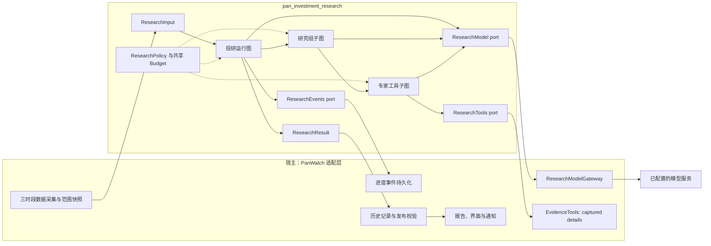
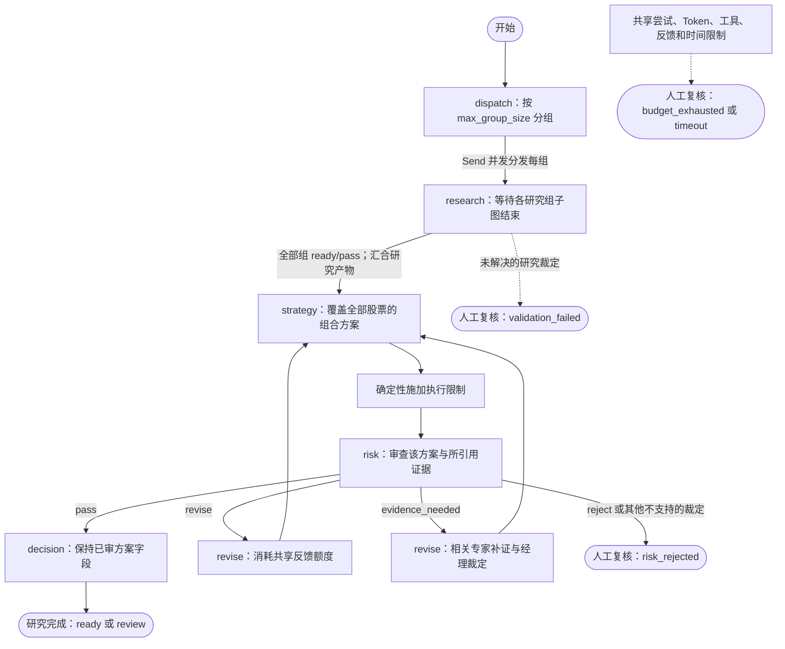
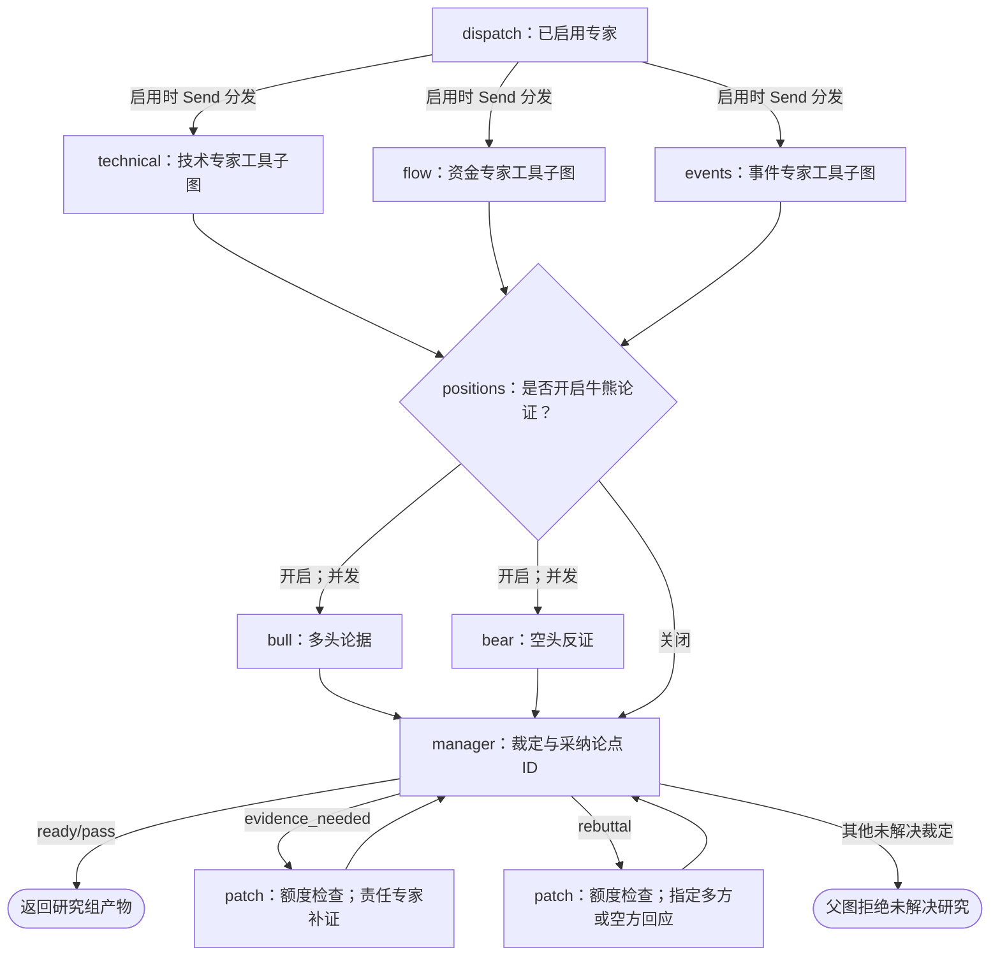

# Pan Investment Research

[English](README.md)

使用 LangGraph 的独立多 Agent 投研包。参考 TradingAgents，提供技术、资金、事件
三类专家，多方与空方研究员，以及研究经理、策略、风控挑战和最终决策角色。
角色可以共用同一个底层模型。

## 边界与接入

包只依赖 Pydantic 与 LangGraph，不导入 PanWatch，不读数据库或凭证，不发通知，
不下单。宿主注入模型、只读工具和事件接口，取得类型化建议及带版本的研究产物。

运行图、研究子图和专家工具子图分别负责组合决策、研究协作及工具回路。
专家并行，子图完整结束后才参与父图汇合。关键争议可定向补证或回应，风控可退回
策略修改；这些反馈共用额度，不会无限循环。

## 设计与架构

以下图描述当前实现的控制流，不代表每次运行都执行全部节点。跨包边界的箭头表示
注入端口调用或返回值，投研包不反向导入宿主适配器。


<details>
<summary>Mermaid 源码（可维护的控制流说明）</summary>



</details>

每次运行的端口、策略、预算和产物放在 `Runtime.context` 的 `Dependencies` 中。
编译后的图可以复用，请求之间不共享可变运行状态。所有研究组、模型回退、工具、
修复和反馈使用同一份运行预算。各层都可通过可选事件端口记录进度。PanWatch 当前
工具只读取已采集证据的完整版本，不在研究中获取更新时点的行情或新闻。

### 1. 投研运行图：多股分组后统一决策


<details>
<summary>Mermaid 源码（可维护的控制流说明）</summary>



</details>

每个 `research` worker 等待子图完整结束后才参与父图汇合。组合策略、风控与最终
决策对全部股票统一执行一次。两个修订框表示同一 `revise` 节点的内部路径：补证
只重跑受影响研究组的责任专家及经理，纯方案修订不重跑完整专家和牛熊论证。
研究未完成不能发布正式建议；图已完成仍可能需要人工复核。

### 2. 研究组子图：专家、牛熊与经理裁定


<details>
<summary>Mermaid 源码（可维护的控制流说明）</summary>



</details>

三个专家框是同一 `expert` worker 按角色分别调用。牛熊是 `positions` 节点内部的
两次并发调用，不是无限辩论。两个补证／回应框是 `patch` 的内部路径：定向处理后
直接回经理，不重新执行全部专家，也不自动重跑双边论证。各反馈路径共享运行额度。

### 3. 专家工具子图：有限轮次的只读补证


<details>
<summary>Mermaid 源码（可维护的控制流说明）</summary>


</details>

每次模型实际发送都先申请尝试额度。工具轮次与调用总数受限，不能扩大股票范围、
补造证据或修改已有证据身份。JSON 修复消耗模型尝试数，并使用全运行共享的一次
修复机会，与反馈次数分别计数。校验失败交由运行入口返回对应的未完成状态。

### 时段配置与效率

以下为 PanWatch 宿主适配层选择的默认值。独立包仅设置 `profile` 不会自动套用这些
预设。

| 宿主时段 | 初始专家 | 牛熊论证 | 尝试数／时间默认上限 | 其他默认项 |
| --- | --- | --- | --- | --- |
| 收盘 | 技术、资金、事件 | 开启 | 18 / 180秒 | 沿用包默认值 |
| 盘前 | 技术、资金、事件 | 默认关闭；有已采集事件条目时开启 | 14 / 90秒 | 可显式配置 |
| 盘中 | 技术；有已采集事件条目时增加事件专家 | 默认关闭；有事件条目时开启 | 10 / 45秒 | 无反馈；2次工具；并发2 |

显式配置专家和论证开关会覆盖自动选择。宿主按股票数量／研究组调整默认尝试、
Token、工具和输出容量，但不自动延长时间上限。额度不等于耗时保证，也不意味着
所有模型都能在默认时间内完成。

不含工具、修复和反馈时，逻辑模型调用数为 `G × (S + 2 × D + 1) + 3`：`G` 是
研究组数，`S` 是启用专家数，论证开启时 `D=1`、否则为 `0`。默认完整单组路径
需要9次调用。专家和牛熊并发、按需论证、批量读取详情、压缩下游输入及定向修订
用于减少重复工作。角色更多不自动代表结论更准，数据／模型质量、耗时与成本仍需
单独评估。

### 提示词归属与旧流程兼容

| PanWatch 模式 | 实际使用的提示词 | 正式输出 |
| --- | --- | --- |
| `legacy`（默认） | 原 `prompts/daily_report.txt`、`premarket_outlook.txt`、`intraday_monitor.txt` | 原 Agent 分析与报告流程 |
| `shadow` | 新角色提示词用于影子研究，随后旧提示词用于原流程 | 原流程输出；保留影子研究产物供检查 |
| `langgraph` | `engine.py` 中的 `ROLES`、公共指令与各角色 schema | 结构化投研结果，由宿主生成报告 |

新图复用原采集器，不调用旧 `build_prompt()`，也不继承它组装的全部输入叙述。
旧 prompt 中的 ATR／异动规则、交易风格、相对强弱和深度研究参考等指令**不会自动
继承**。其中有用的业务语义，需要明确迁入证据、契约、角色提示词或确定性校验并
验证；报告章节与排版交给宿主渲染器。独立包不读取 PanWatch 的旧提示词文件，当前
也没有运行时注入自定义提示词模板的接口。模式切换是显式的，新图异常不自动重试
旧流程。

### 源码索引

| 文件 | 职责 |
| --- | --- |
| [contracts.py](src/pan_investment_research/contracts.py) | 输入、证据、角色报告、建议、策略与结果契约 |
| [engine.py](src/pan_investment_research/engine.py) | 三层图、角色提示词、反馈、校验及执行限制 |
| [budget.py](src/pan_investment_research/budget.py) | 共享尝试／Token／工具／反馈计数和并发控制 |
| [ports.py](src/pan_investment_research/ports.py) | 模型、可选只读工具与可选事件端口 |
| [tests/test_research.py](tests/test_research.py) | 脚本模型契约与图回归场景 |

## 安装与使用

```sh
python -m pip install ./packages/pan-investment-research
python -m pytest packages/pan-investment-research/tests -q
```

```python
from pan_investment_research import InvestmentResearch, ResearchInput, ResearchPolicy

result = await InvestmentResearch().run(
    ResearchInput.model_validate(prepared_input),
    model=my_model_adapter,
    tools=my_read_only_tools,
    events=my_event_sink,
    policy=ResearchPolicy(),
)
```

接口见 `ports.py`。模型适配器的每次真实发送，包括 fallback 和 retry，都必须先
等待 `before_attempt()`；关闭 SDK 隐式重试。用量来自该次响应，不通过共享计数
相减。无法确认的用量保留 unknown。

股票键使用 `market:symbol`。输入时间带时区，证据不能越过范围或分析截点。
论点必须引用可见证据。工具按角色授权，只返回范围内证据，不修改已有证据身份。
公告与新闻中的文字属于业务资料，不是执行指令。

## 预算与结论

单研究组完整基础路径为九次逻辑调用，工具、修复和反馈另外计数；多研究组需要
独立核算预算，组合策略、风控和决策统一执行。限制包括实际尝试数、保守 token
预留、工具数、反馈数、并发、输出规模与时间。预估 token 不等于真实账单。

`ready` 表示产物通过包内已经实现的检查，不代表收益保证、完整市场规则验证或
已经核验购买力。缺少币种、结算资料不能授权数量。最终决策不能改变已过风控的
方案。关键争议未解决或预算不足时返回 `review` 及独立的 `completion` 原因，不生成虚假的
观望建议。已校验的策略观点仅保留为受限草案；策略尚未形成时建议列表为空。基础设施错误
交给宿主处理，取消不会被吞掉。

宿主负责最新账户与市场约束、持久化、幂等交付、通知及持久恢复。默认不启用
checkpoint 恢复。包内测试使用脚本模型与回放资料，不能作为真实模型质量或收益
验证的证据。

## 分开表达观点、建议与执行

每条建议包含基于证据的 `outlook`（看多／中性／看空）、0–1 的模型置信度、
条件性的组合 `action`，以及 `execution_status` / `execution_constraints`。置信度
不是经过校准的收益概率。零资金、购买力未核实、报价过期、需人工复核只限制执行，
不把有依据的看多或买入机会改成观望。市场专家不接收账户快照；账户限制在风控与
定稿前由确定性逻辑施加。

`completion=complete` 与超时、预算耗尽、校验失败、风控拒绝分开。图已完成仍可需
人工复核；图未完成时的草案不得发布到正式建议池或预测统计。0.2 版本要求观点与
置信度；宿主继续读取旧报告，不补造缺失字段。所有结果均不代表下单授权。
